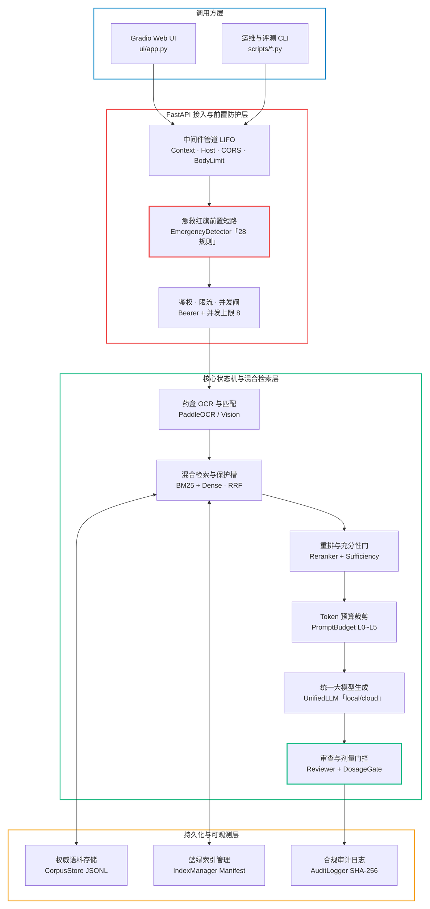

# MedCopilot（妙手回春） — Agentic 医疗 RAG 问答系统

[](LICENSE)
[](https://www.python.org/)

> **重要合规与免责声明**：本项目按 **MIT License** 开源，
> 定位为**可复现的教学与工程研究型医疗 RAG 样例**，
> **不是医疗器械、临床决策支持系统（CDSS）或互联网诊疗服务**。
> 请勿将任何系统输出用于临床诊断、处方开具、剂量决定或替代线下就医。
> 急重症请立即拨打 **120** 或前往就近急诊。

> **项目背景**：本仓库是 2025 浙江大学软件学院 AI 夏令营（ZJUSE AI Camp）考核产出的 AI 工程项目，按工程开源标准整理发布。

**MedCopilot（妙手回春）** 是一个完全自包含（Zero External Repo Coupling）、
无 LangChain/LangGraph 依赖的医疗药品说明书问答系统，内置确定性安全护栏、
多模态药盒 OCR、混合检索（BM25 + Dense + RRF + CrossEncoder 重排）
与完整的可复现评测/发布工具链。

> **命名约定**：产品名为 **MedCopilot（妙手回春）**；
> Python 包与仓库目录名为 `medcopilot`（与产品名同源对应），
> 文档与发布物料统一使用产品名指代。

---

## 系统架构与多模态咨询交互总览



**图 1　全链路请求与多层医疗安全护栏架构总览**

---

## 核心特性

1. **完全自包含的状态机编排（No LangChain / LangGraph）**
   - `workflow/agent_graph.py` 实现 `triage → pharmacist → reviewer` 确定性状态机；
   - `common/` 内置独立的 `AppConfig`（Pydantic Settings）、
结构化脱敏日志（Loguru）与崩溃安全原子写原语（`fsutil`）。
2. **临床级确定性安全护栏（Safety-by-Construction）**
   - **急救毫秒级短路**：`EmergencyDetector` 在任何检索、
OCR 或 LLM 调用前拦截心脑血管、神经、中毒、自伤、呼吸及病程演进（Trajectory）
红旗，直接返回 120 急救指引；
   - **剂量门控（`DosageGate`）**：
默认 `DOSAGE_GATE_MODE=redact` 剥离全部具体剂量数字并转介医嘱；
`quote` 模式仅在证据含禁忌/相互作用/注意事项等安全章节且逐字匹配说明书原文时放行；
任何改写或编造剂量一律弃答（Abstain）；
   - **说明书入库预校验（`IngestValidator`）**：
在切分与建索引前强制校验必填主章节（药品名称/适应症/功能主治任一命中）、
剂量单位白名单与单次极量上限，并拦截裸小数点与提示词注入特征。
3. **四大模型能力「默认离线本地 + 显式开关切换云端」**
   - **LLM、Embedding、Reranker、OCR** 四项能力默认均运行在本地/离线模式（`MODEL_WEIGHTS_OFFLINE=true`）
，不向任何外部云服务发起请求；
   - 支持按需通过显式开关切换至 OpenAI 兼容云端 API，
并由数据出网门禁（`ALLOW_TEXT_EGRESS` / `ALLOW_IMAGE_EGRESS`）
与生产环境 HTTPS 强校验双重保护。
4. **生产级 API 与可观测性**
   - ASGI 层预解析请求体字节上限（`BodySizeLimitMiddleware`）、
按端点滑动窗口限流与并发闸；
   - 免 PHI 的 SHA-256 哈希链审计日志（`AuditLogger`）
与蓝绿索引原子切换（`IndexManager`）。

---

## 目录结构

```text
medcopilot/
├── .github/         # GitHub Actions CI 工作流与 Issue / PR 模板
├── agents/          # 分诊路由 (triage) / 本地 PaddleOCR (ocr_tool) / 云端视觉 OCR (ocr_api)
├── api/             # FastAPI 服务端、环境分类门禁、滑动窗口限流、有界 TTL 会话存储、Prometheus 指标
├── audit/           # 免 PHI 的 SHA-256 哈希链审计日志与合规保留策略
├── common/          # MedCopilot 独立基础库：config.py (AppConfig) / logger.py (脱敏日志) / fsutil.py (原子写)
├── configs/         # 只读配置参考镜像：medcopilot.yaml / triage_keywords.txt / clinical_sections.txt
├── datasets/        # 版本化资产：金标评测集 (eval/) / Embedding 评测对 / 安全策略工件 (policies/)
├── deploy/          # 生产容器入口 (entrypoint.py / docker-entrypoint.sh) 与 systemd 服务/备份单元
├── docs/            # 结构化技术文档集：INDEX / 架构与算法 / 安全策略 / 评测门禁 / API与配置参考 / 生产部署
├── evaluation/      # 确定性金标评测器 (golden_eval) 与可选官方框架适配器 (rag_official_adapter)
├── llm/             # 多厂商统一 LLM 适配层 (local / cloud, openai_compatible / qianfan / zhipu / mock)
├── loadtests/       # Locust 压测脚本（打包时自动排除）
├── rag/             # 临床章节切分器、入库校验器、BM25+Dense 混合检索、本地/云端 Embedding 与 Reranker、蓝绿索引管理
├── safety/          # 策略工件签名校验、代码等价守护与禁忌触发器
├── scripts/         # 17 个评测、策略检查、恢复演练、压测、快照备份、依赖锁导出、脱敏扫描与发布证据包 CLI
├── tests/           # 全量单元、契约、安全红线、云端适配器 Mock 与恢复演练测试套件（含本地 conftest.py）
├── ui/              # Gradio 交互前端（纯 HTTP API 消费者，经 api_client 通信）
├── workflow/        # 自包含状态机 (agent_graph)、急救红旗检测器、剂量门与 Token 预算裁剪器
├── .dockerignore    # 容器构建上下文排除规则
├── .env.example     # MedCopilot 环境变量配置模板（92 项 AppConfig 别名 + HF 离线开关）
├── .gitignore       # Git 忽略规则
├── Dockerfile       # 单阶段非 root 生产交付镜像
├── LICENSE          # MIT 开源许可证
└── pyproject.toml   # PEP 621 项目打包与工具链配置
```

---

## 快速开始（离线可复现模式）

无需 GPU、无需任何云端 API Key、不下载模型权重：

```bash
python -m venv .venv
# Windows: .venv\Scripts\activate
# Linux/macOS: source .venv/bin/activate
python -m pip install -e ".[dev]"

# 1. 运行 MedCopilot 全量单元测试（离线 Mock）
MOCK_LLM=1 PYTHONPATH=. python -m pytest medcopilot/tests/ -m "not slow" -v

# 2. 运行四大核心工程与安全门禁
MOCK_LLM=1 PYTHONPATH=. python medcopilot/scripts/eval_golden.py
MOCK_LLM=1 PYTHONPATH=. python medcopilot/scripts/emergency_eval.py
MOCK_LLM=1 PYTHONPATH=. python medcopilot/scripts/policy_check.py
MOCK_LLM=1 PYTHONPATH=. python medcopilot/scripts/recovery_drill.py
```

### 启动 API 服务与 Web 界面

```bash
# 终端 1：启动 FastAPI 服务（开发模式）
PROJECT_ENV=development MOCK_LLM=1 PYTHONPATH=. python -m uvicorn medcopilot.api.server:app --host 127.0.0.1 --port 8000

# 终端 2：启动 Gradio 前端（默认连接 http://127.0.0.1:8000）
PROJECT_ENV=development PYTHONPATH=. python -m medcopilot.ui.app
```

---

## 本地模式与云端模型切换配置

四大模型组件默认全部为 **`local`**（离线优先），
仅在显式配置切换开关及出网许可后才会调用云端接口：

**表 1　四大模型能力本地/云端切换配置总览**

| 能力模块 | 默认模式（离线本地） | 显式云端开关 | 必填出网授权开关 | 核心云端配置项 |
| :--- | :--- | :--- | :--- | :--- |
| **LLM 生成** | `LLM_MODE=local` | `LLM_MODE=cloud` | `ALLOW_TEXT_EGRESS=true` | `LLM_PROVIDER`、`LLM_API_BASE`、`LLM_API_KEY`、`LLM_MODEL` |
| **Dense Embedding** | `EMBEDDING_PROVIDER=local` | `EMBEDDING_PROVIDER=cloud` | `ALLOW_TEXT_EGRESS=true` | `ENABLE_CHROMA_DENSE=true`、`EMBEDDING_API_BASE`、`EMBEDDING_API_KEY`、`EMBEDDING_MODEL` |
| **Reranker 重排** | `RERANK_PROVIDER=local` | `RERANK_PROVIDER=cloud` | `ALLOW_TEXT_EGRESS=true` | `RERANK_API_BASE`、`RERANK_API_KEY`、`RERANKER_MODEL` |
| **药盒 OCR** | `OCR_PROVIDER=local` | `OCR_PROVIDER=cloud` | `ALLOW_IMAGE_EGRESS=true` | `OCR_API_BASE`、`OCR_API_KEY`、`OCR_API_MODEL`、`OCR_API_TIMEOUT` |

> **生产环境强校验（Fail-Closed）**：当 `PROJECT_ENV=production` 时，
> 任何启用 `cloud` 模式的组件必须配置对应的 `ALLOW_TEXT_EGRESS=true`（或 `ALLOW_IMAGE_EGRESS=true`）
> 、非占位符密钥以及 `https://` 端点；
> 缺失任意一项将在应用启动阶段直接拒绝启动。

---

## 评测与运维脚本一览

**表 2　评测与运维 CLI 脚本清单**

| 脚本路径 | 用途说明 |
| :--- | :--- |
| `scripts/eval_golden.py` | 版本化 RAG 金标集确定性行为门（分诊、召回、拒答、安全护栏） |
| `scripts/eval_rag.py` | 保守抽取式词法忠实度与上下文相关度评测代理（默认 Mock 下按设计退出 1） |
| `scripts/eval_embedding.py` | 医疗说明书检索对 Embedding 模型召回评测（Recall@k / MRR） |
| `scripts/build_embedding_eval.py` | 从金标语料构建确定性 Embedding 评测对数据集 |
| `scripts/emergency_eval.py` | 急救红旗词表召回率、误报率与病史叙事降级准确率门禁 |
| `scripts/policy_check.py` | `safety_policy_v1.json` 签名指纹与代码常量逐字节等价守护 |
| `scripts/policy_sign.py` | 医疗安全策略工件 HMAC-SHA256 签名与临床评审签核工具 |
| `scripts/recovery_drill.py` | 8 场景故障恢复演练（坏行降级、蓝绿回滚、策略防篡改、审计链校验、快照恢复） |
| `scripts/load_check.py` | 真实 Uvicorn 子进程并发连接层健康与分位数延迟检查 |
| `scripts/llm_probe.py` | 单 Provider LLM 连通性、鉴权与延迟诊断探针 |
| `scripts/llm_matrix_probe.py` | 多 Provider 配置矩阵就绪度与连通性批量诊断 |
| `scripts/ocr_probe.py` | 本地 PaddleOCR 引擎可用性与推理自检探针 |
| `scripts/prepare_weights.py` | 离线部署镜像的模型权重预拉取与 SHA-256 指纹清单生成 |
| `scripts/backup_snapshot.py` | 权威语料与索引 Manifest 的 SHA-256 校验快照备份与恢复工具 |
| `scripts/export_lock.py` | 从 `uv.lock` 导出带 `--hash=sha256:...` 的可复现依赖锁并校验同步性 |
| `scripts/redact_scan.py` | 发布产物与日志的凭据/Bearer/PHI 泄漏静态扫描门禁 |
| `scripts/release_pack.py` | 聚合全量测试、安全门禁与环境元数据的发布证据包生成器 |

---

## 文档导航

**表 3　文档体系导航**

| 文档 | 核心内容 |
| :--- | :--- |
| **[docs/INDEX.md](medcopilot/docs/INDEX.md)** | 文档体系总览、按角色阅读路径图与「源码模块 $\leftrightarrow$ 文档章节 $\leftrightarrow$ 测试套件」双向索引 |
| **[docs/ARCHITECTURE_AND_ALGORITHMS.md](medcopilot/docs/ARCHITECTURE_AND_ALGORITHMS.md)** | 全链路请求生命周期、自包含状态机、Token 预算裁剪、入库校验、章节切分、BM25+Dense RRF、安全保护槽、蓝绿索引与四模型本地/云端适配规范 |
| **[docs/SAFETY_POLICY.md](medcopilot/docs/SAFETY_POLICY.md)** | 三层确定性医疗安全护栏（急救红旗 28 规则（27 专科 + 1 病程演进）、句子词元覆盖率与逐句相等核验、`DosageGate`、`safety_policy_v1.json` 签名与专家复核流程） |
| **[docs/EVALUATION_AND_QUALITY_GATES.md](medcopilot/docs/EVALUATION_AND_QUALITY_GATES.md)** | 金标行为门、急救红旗门、抽取式评测代理、Embedding 评测、8 场景恢复演练、发布证据包与脱敏扫描规范 |
| **[docs/CLI_API_AND_CONFIG_REFERENCE.md](medcopilot/docs/CLI_API_AND_CONFIG_REFERENCE.md)** | 全量 92 项 `AppConfig` 参数字典、8 个 FastAPI HTTP 端点契约与全部 17 个 CLI 脚本参考手册 |
| **[docs/PRODUCTION_DEPLOY.md](medcopilot/docs/PRODUCTION_DEPLOY.md)** | 单机 systemd 与 Docker 生产部署、92 键 secret 白名单、Prometheus 告警、备份恢复与发布阻断门 |
| **[docs/RELEASE_CHECKLIST.md](medcopilot/docs/RELEASE_CHECKLIST.md)** | 发布前证据包、供应链哈希锁、蓝绿灰度切换、故障恢复对照表与四维回滚清单 |
| **[docs/OPEN_SOURCE_PRACTICES.md](medcopilot/docs/OPEN_SOURCE_PRACTICES.md)** | 业界开源医疗/通用 RAG 与安全护栏框架的设计模式借鉴边界与许可证隔离说明 |
| **[docs/REFACTORING_AND_AUDIT_REPORT.md](medcopilot/docs/REFACTORING_AND_AUDIT_REPORT.md)** | 原始实现缺陷复盘、自包含模块化架构演进、安全与并发加固纪要及已知边界 |

