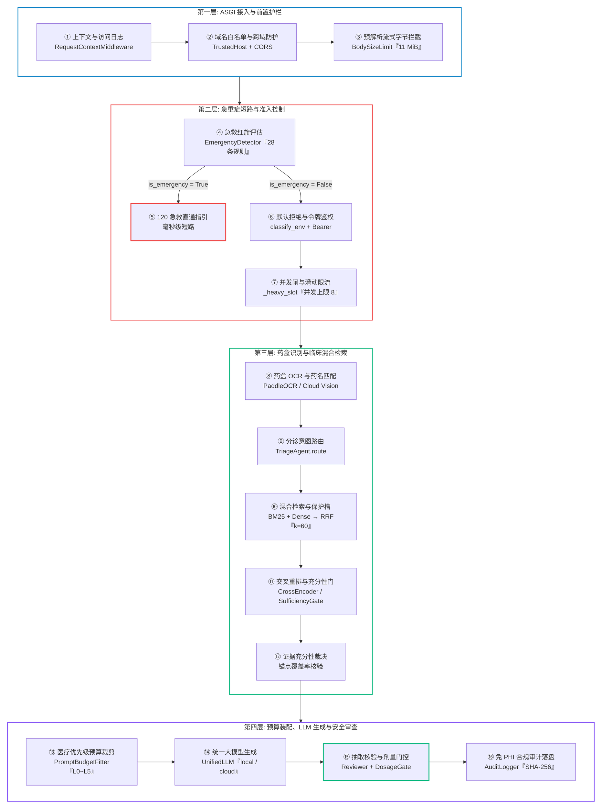
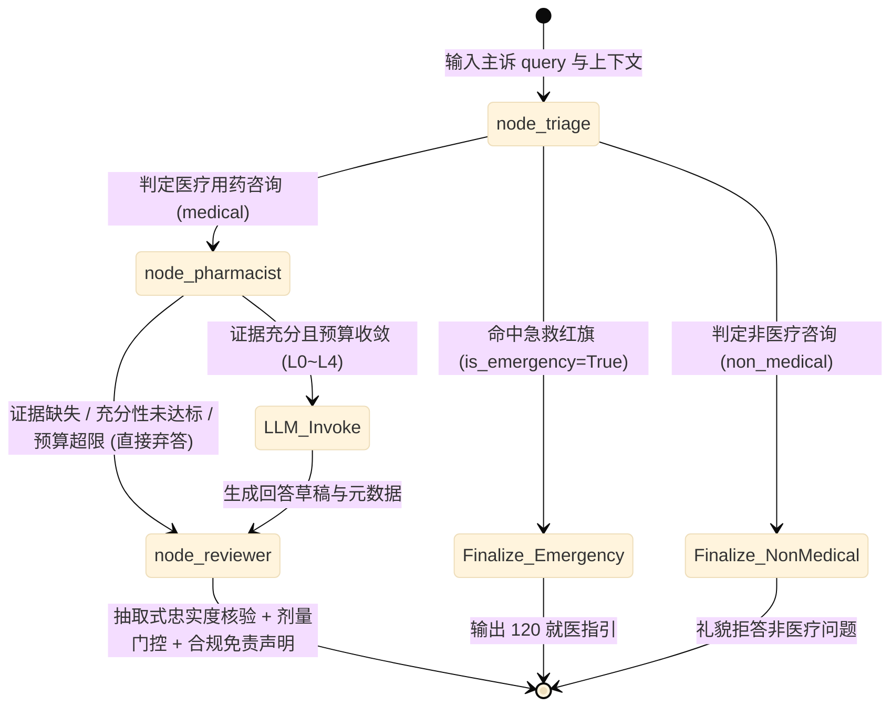
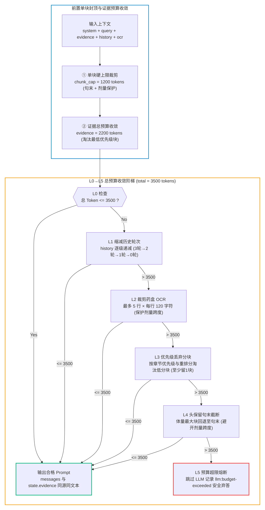
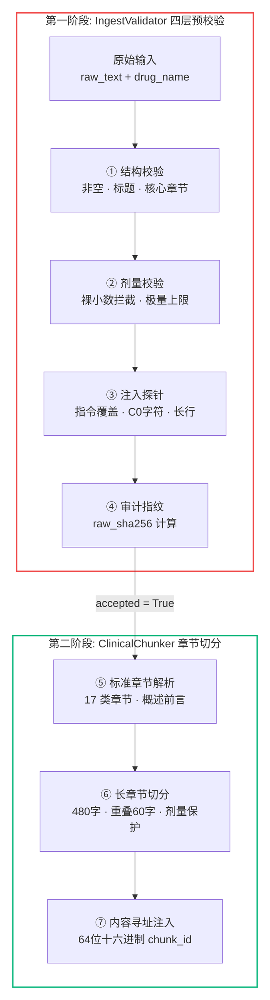
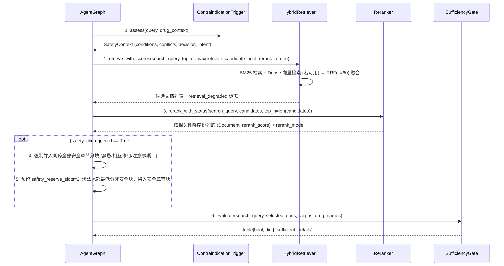
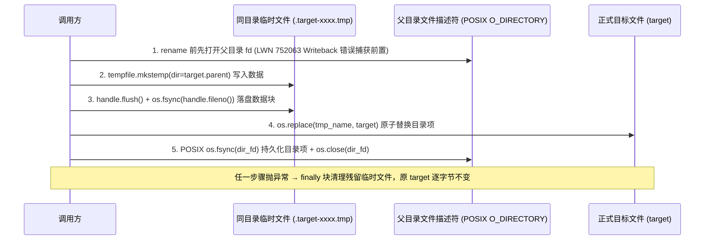
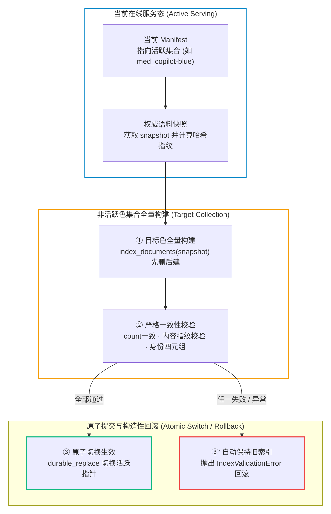
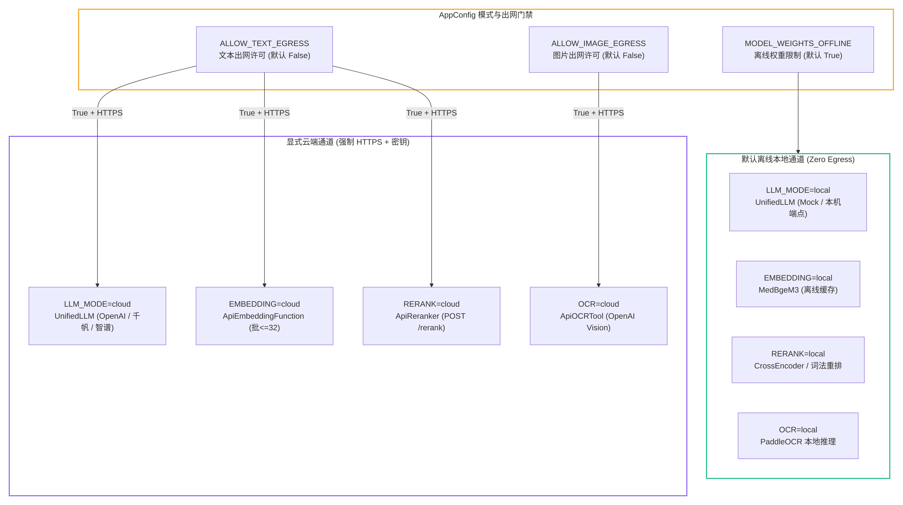

# 系统架构、状态机与核心算法规范（Architecture, State Machine & Mathematical Specification）

本文档深入阐述 MedCopilot（妙手回春），代码包标识 `medcopilot`，
的全链路请求生命周期、确定性自包含状态机、临床章节切分与入库预校验算法、
BM25+Dense 混合检索与 RRF 融合数学规范、安全章节保护槽、蓝绿索引原子切换协议，
以及四大模型能力（LLM / Embedding / Reranker / OCR）
「默认离线本地 + 显式云端出网门禁」的适配架构。
所有参数、状态码与降级标签均与源码逐一对齐并由自动化测试锁定。

---

## 全链路请求与多层医疗安全护栏架构总览

**图 1　全链路请求与多层医疗安全护栏架构总览**

---

## 1. 自包含状态机与 Token 预算裁剪（`workflow/agent_graph.py` & `workflow/prompt_budget.py`）

`medcopilot` 完全不依赖 LangChain 或 LangGraph，
在 `workflow/agent_graph.py` 中实现零外部框架耦合的确定性状态机 `AgentGraph`。

### 1.1 状态对象 `ConsultationState` 与执行节点转换图

`AgentGraph` 围绕单次调用私有的状态对象 `ConsultationState`（`workflow/agent_graph.py:46-97`）
顺序驱动三个确定性节点，并通过不可变的 `ConsultationResult` 返回：

**图 2　AgentGraph 状态机与早退短路流转**

### 1.2 确定性 Token 估算器与 L0→L5 医疗优先级裁剪阶梯（`workflow/prompt_budget.py`）

为防止超长说明书分块、
多轮对话历史或药盒 OCR 噪声撑爆上下文窗口或挤占核心禁忌信息，
`workflow/prompt_budget.py` 实现了零分词器依赖、
偏保守上界的确定性 Token 估算器与五级裁剪阶梯：

**图 3　L0→L5 医疗优先级预算裁剪阶梯**

1. **字符级保守 Token 估算公式（`estimate_tokens`，`prompt_budget.py:70-83`）**：
   设文本 $T$ 的总字符数为 $\lvert T \rvert$，
其中落在 CJK 表意文字与全角区间（`0x2E80–0x9FFF`、`0x3400–0x4DBF`、
`0xF900–0xFAFF`、`0xFF00–0xFFEF`）的字符数为 $N_{\text{CJK}}(T)$，
则单条文本的估算 Token 数为：

$$
\widehat{\operatorname{tokens}}(T) = N_{\text{CJK}}(T) + \left\lceil \frac{\lvert T \rvert - N_{\text{CJK}}(T)}{4} \right\rceil \tag{1}
$$

式中：
- $T$ —— 待估算的原始文本；
- $N_{\text{CJK}}(T)$ —— $T$ 中落在 CJK 表意文字与全角区间的字符数；
- $\lvert T \rvert$ —— $T$ 的总字符数。

   包含每条消息固定信封开销（`MESSAGE_OVERHEAD_TOKENS = 4`）
的完整消息序列 $\mathcal{M}$ 总估算 Token 数为：

$$
\widehat{\operatorname{tokens}}(\mathcal{M}) = \sum_{m \in \mathcal{M}} \left(\widehat{\operatorname{tokens}}(m_{\text{content}}) + 4\right) \tag{2}
$$

式中：
- $\mathcal{M}$ —— 发送给 LLM 的完整消息序列；
- $m_{\text{content}}$ —— 第 $m$ 条消息的正文；
- 常数 4 —— 每条消息固定的角色信封开销（MESSAGE_OVERHEAD_TOKENS）。

2. **临床章节优先级映射（`_priority`，`prompt_budget.py:38-45, 242-245`）**：
   设受保护安全章节集合为 $\mathcal{S}_{\text{safe}} = \{\text{禁忌}, \text{药物相互作用}, \text{注意事项}, \text{孕妇及哺乳期妇女用药}, \text{儿童用药}, \text{老年用药}\} \cup \mathcal{S}_{\text{protected}}$，
则各章节的裁剪保护优先级得分 $P(s) \in \{0, 1, 2, 3, 4\}$ 为：

$$
P(s) = 4 \cdot \mathbb{I}[s \in \mathcal{S}_{\text{safe}}] + 3 \cdot \mathbb{I}[s = \text{用法用量}] + 2 \cdot \mathbb{I}[s = \text{不良反应}] + 1 \cdot \mathbb{I}[s = \text{适应症}] \tag{3}
$$

式中：
- $s$ —— 证据分块所属的临床章节名；
- $\mathbb{I}[\cdot]$ —— 指示函数（条件成立取 1，否则取 0）；
- $\mathcal{S}_{\text{safe}}$ —— 受保护安全章节集合（禁忌/相互作用/注意事项等与部署方 protected_sections 的并集）。

   在 L3 丢弃候选块时，
淘汰索引 $i^*$ 由字典序最小键唯一确定（优先级最低 $\rightarrow$ 重排得分最低 $\rightarrow$ 位置最靠后）：

$$
i^* = \arg\min_{0 \le i < \lvert \mathcal{C} \rvert} \big(P(s_i),\; \text{rerank\_score}_i,\; -i\big) \tag{4}
$$

式中：
- $\mathcal{C}$ —— 当前候选证据块序列；
- $P(s_i)$、$\text{rerank\_score}_i$ —— 第 $i$ 块的章节优先级与重排得分；
- $-i$ —— 位置序取负，保证同分时优先淘汰靠后者。

3. **同源硬不变量**：
`fit()` 返回的 `BudgetFit.evidence` 与填入 `messages` 的证据文本逐字同源，
确保后置 `MedicalSafetyGuard` 与 `DosageGate` 核验的正是 LLM 实际看到的文本，
彻底消除“截断漂移”。

---

## 2. 临床说明书入库预校验与章节感知切分（`rag/ingest_validator.py` & `rag/clinical_chunker.py`）

### 2.1 摄取预校验与章节切分全流程架构图

**图 4　摄取预校验与临床章节切分流程**

### 2.2 摄取端四层确定性预校验闸门（`IngestValidator.validate`）

`/documents/drug-label` 在对原始 `raw_text` 和 `drug_name` 做任何空白折叠、
截断、分块或建索引之前，
先调用 `IngestValidator.validate`（`rag/ingest_validator.py:97-183`，
针对 OWASP LLM08:2025 向量库投毒防护）：

**表 1　IngestValidator 四层预校验判定规则与拒绝原因码**

| 校验阶段 | 判定逻辑与数学/正则边界 | 拒绝原因码 (`reasons`) |
| :--- | :--- | :--- |
| **1. 文本与结构校验** | ① `raw_text` 经 NFKC 归一化后非空；② 行首章节标题识别数 = 0 时按长度分流（不足 `INGEST_MIN_RAW_CHARS` = 30 判长度不足，已达标判无可识别章节）；③ 识别到章节但全文不足 10 字符（截断残留）；④ 未命中 `{药品名称, 适应症, 功能主治}` 任一主章节（药名非空与药名纯净性由 API 层 422 与注入探针共同保障） | `structure:empty` `structure:min-length` `structure:no-recognized-section` `structure:missing-primary-section` |
| **2. 剂量单位与极量合理性** | ① 提取所有 `(\d+(?:\.\d+)?)\s*(单位)` 并经 `UNIT_ALIASES` 归一：白名单外单位拒绝；超过生理/包装合理上限 `UNIT_MAXIMA`（如 `g > 100`、`mg > 200000`、`片/粒 > 30`、`ml > 2000`）拒绝；② 比值剂量表达式（如 `1/2 mg`）同走白名单校验；③ 拒绝裸小数 `_BARE_DECIMAL_RE`（如 `"一次0.375。"` 小数后无合法剂量/时间单位即结束，防 OCR 截断单位） | `dose:bad-unit:{unit}` `dose:implausible:{unit}` `dose:bare-decimal` |
| **3. 提示注入与控制字符探针** | ① 中英文指令劫持正则 `_INJECTION_PATTERNS`（`忽略以上指令`、`ignore previous instructions`、`system: you are`、伪造不可信围栏标签，或药名含 `【】`/换行）；② C0 控制字符 `[\x00-\x08\x0b\x0c\x0e-\x1f]`（正文或药名）；③ 单行超 `INGEST_MAX_LINE_CHARS` = 4000 且前 200 字符无中文标点的 blob 行 | `injection:prohibited-pattern` `injection:control-characters` `injection:blob-like-line` |
| **4. 原始摄取指纹** | 计算归一化全文与药名的 SHA-256 摘要作为 `raw_sha256` 写入审计事件 | 供事后法医溯源 |

原始摄取指纹 `raw_sha256` 的计算公式为：

$$
\text{raw\_sha256} = \operatorname{SHA256}\Big(\operatorname{UTF8}\big(\operatorname{NFKC}(\text{raw\_text}) \mathbin{\Vert} \texttt{\textbackslash x00} \mathbin{\Vert} \text{drug\_name}\big)\Big) \tag{5}
$$

式中：
- $\operatorname{NFKC}(\cdot)$ —— Unicode NFKC 归一化；
- $\operatorname{UTF8}(\cdot)$ —— UTF-8 编码；
- $\mathbin{\Vert}$ —— 字节串拼接；
- $\texttt{\textbackslash x00}$ —— 空字节分隔符，隔离正文与药名防止拼接歧义；
- $\text{raw\_text}$ —— 原始说明书全文；
- $\text{drug\_name}$ —— 药品通用名。

### 2.3 临床章节感知切分器（`ClinicalChunker.chunk_drug_label`）

`ClinicalChunker`（`rag/clinical_chunker.py:14-216`，
版本标识 `VERSION = "chunker-v2-section-aware-dose-protect-spoken"`）
专为中文药品说明书设计：

1. **行首锚定章节识别**：
仅匹配行首 `^\s*(?:【(章节名)】|(章节名)\s*[:：])`（覆盖 17 个标准临床章节：
`药品名称`、`成份`、`性状`、`适应症`、`功能主治`、`规格`、`用法用量`、
`不良反应`、`禁忌`、`注意事项`、`孕妇及哺乳期妇女用药`、`儿童用药`、
`老年用药`、`药物相互作用`、`药物过量`、`药理毒理`、`贮藏`），
避免正文句子中提及“不良反应”被误切为新章节；首个标题前的文字归入 `概述前言`。
2. **保护剂量跨度的长章节切分（`_split_long`）**：
   - 目标分块上限 `CHUNK_MAX_CHARS = 480`（配合约 35 字符的药名/章节前缀，
恰好适配 `bge-reranker-base` 的 `512` 位置上限），
硬上限 `HARD_MAX_CHARS = 960`，相邻子块重叠 `CHUNK_OVERLAP = 60` 字符。
   - 切点候选按结构优先级打分：换行 `\n`（4）$>$ 句末标点 `。！？；;`（3）
$>$ 逗顿 `，,、`（2）$>$ 空白（1）。
   - **剂量跨度防切断**：任何落在 `DOSE_PROTECT_PATTERN`（涵盖阿拉伯/中文数字、
`半`、分数 `1/2` 或 `二分之一`、Unicode 分数 `½` + 剂量单位，
以及 `一日三次`/`早晚各一粒` 等给药频次）内部的切点一律剔除；
若极端无标点长文本的硬切点落在剂量跨度内，
切点自动推至该剂量跨度末尾（或回退至起点）。
3. **内容寻址确定性 `chunk_id` 与元数据注入**：
   每个生成的 `Document` 注入 `drug_name`、`section`、`is_contraindication`、
`chunk_type` 及 64 位十六进制内容寻址 ID：

$$
\text{chunk\_id} = \operatorname{SHA256}\Big(\operatorname{UTF8}\big(\text{drug\_name} \mathbin{\Vert} \texttt{":"} \mathbin{\Vert} \text{section} \mathbin{\Vert} \texttt{":"} \mathbin{\Vert} \text{part\_index} \mathbin{\Vert} \texttt{":"} \mathbin{\Vert} \text{raw\_part}\big)\Big) \tag{6}
$$

式中：
- $\text{drug\_name}$ —— 药品通用名；
- $\text{section}$ —— 所属临床章节；
- $\text{part\_index}$ —— 该章节内的分片序号；
- $\text{raw\_part}$ —— 未拼接富集前缀的原始分片文本。
无章节兜底块以数字序号替代 section 段，
概述前言块使用字面量 `preamble` 段——三类路径的 chunk_id 互不碰撞。

---

## 3. 混合检索、RRF 融合、安全章节保护槽与充分性门（`rag/hybrid_retriever.py` & `safety/section_policy.py`）

### 3.1 混合检索、安全保护槽与充分性门交互时序图

**图 5　混合检索·安全保护槽·充分性门交互时序**

### 3.2 中英混合分词与倒数排名融合（RRF）

1. **中英与剂量感知分词器 `HybridRetriever._tokenize(text)`**（`rag/hybrid_retriever.py:72-74`）：
   - 提取单个 CJK 汉字与连续英文字母串/数字串（如 `"胃溃疡"` → `["胃", "溃", "疡"]`、
`bge`、`0.5`）；
   - 正则表达式为 `[\u4e00-\u9fff]|[A-Za-z]+|\d+(?:\.\d+)?`，
保证医学术语单字召回与英文/数字剂量单元的完整性。
2. **倒数排名融合（Reciprocal Rank Fusion, RRF）**（`rag/hybrid_retriever.py:204-221`）：
   `bm25_search_with_scores` 返回原始 BM25Okapi 得分并按降序排序。
当稠密检索器（`ChromaDenseEncoder`）可用且未处于故障冷却期时，
设文档 $d$ 在词法路（BM25）与稠密路（Dense）
中的 0-based 排名分别为 $r_{\text{BM25}}(d)$ 与 $r_{\text{Dense}}(d)$，
平滑常数 $k = 60$（`config.rrf_k`），则融合得分为：

$$
\operatorname{Score}_{\text{RRF}}(d) = \sum_{m \in \{\text{BM25}, \text{Dense}\}} \frac{1}{k + r_m(d) + 1} \tag{7}
$$

式中：
- $m$ —— 检索通道（BM25 词法路或 Dense 稠密路）；
- $r_m(d)$ —— 文档 $d$ 在通道 $m$ 中的 0 基排名；
- $k$ —— RRF 平滑常数（config.rrf_k，默认 60）。
融合得分返回前按可达上限 $\tfrac{M}{k+1}$（$M$ 为参与融合的通道数）
归一化至 $[0, 1]$（单路降级时按 $\tfrac{1}{k+1}$ 归一），
同分按 `page_content` 字典序稳定排序。

   > **单路诚实降级不变量**：当未配置稠密编码器、向量维度不匹配、
出现 NaN/Inf 或处于 30 秒故障冷却期（`hybrid_retriever.py` 内联常量 `30.0`）
时，`retrieve_with_scores` **只使用 BM25 单路**，
并在返回状态中置 `degraded = True`（触发响应降级码 `retrieval:lexical-fallback`）
，**绝不**将内部 TF-IDF 字符 n-gram 兜底当作第二路信号参与 RRF 融合，
防止同源词法信号双重计权伪造高分。

### 3.3 证据充分性门（`SufficiencyGate`）数学定义

`SufficiencyGate`（`safety/section_policy.py:78-177`）
从 NFKC 归一化后的提问（及 OCR 匹配药名）
中提取锚点集合 $A(q)$（包含语料库已知药名整词、
剔除 50 个汉语虚词 `STOP_CHARS` 后的连续汉字二元组、
长度 $\ge 2$ 的英文词与数字片段）。
设单篇证据分块 $d_i \in \mathcal{D}$ 命中的提问锚点子集为 $A(d_i) \subseteq A(q)$，
则单文档最高覆盖率 $\operatorname{cov}_{\text{doc}}$ 为：

$$
\operatorname{cov}_{\text{doc}}(q, \mathcal{D}) = \max_{d_i \in \mathcal{D}} \frac{\lvert A(d_i) \rvert}{\lvert A(q) \rvert} \tag{8}
$$

式中：
- $A(q)$ —— SufficiencyGate.anchors 从提问与 OCR 药名中提取的锚点集合；
- $A(d_i)$ —— 证据分块 $d_i$ 命中的锚点子集；
- $\mathcal{D}$ —— 本轮召回的证据分块集合。

证据集合并集覆盖率 $\operatorname{cov}_{\text{union}}$ 为：

$$
\operatorname{cov}_{\text{union}}(q, \mathcal{D}) = \frac{\left\lvert \bigcup_{d_i \in \mathcal{D}} A(d_i) \right\rvert}{\lvert A(q) \rvert} \tag{9}
$$

式中符号与式(8)一致：分子取全部证据分块命中锚点的并集规模。

当 $\lvert A(q) \rvert > 0$ 时，
充分性门通过的充要条件为同时满足以下两个不等式及显式意图章节约束（`required_sections`）：

$$
\operatorname{cov}_{\text{doc}}(q, \mathcal{D}) \ge \tau_{\text{doc}} = 0.10 \tag{10}
$$

$$
\operatorname{cov}_{\text{union}}(q, \mathcal{D}) \ge \tau_{\text{union}} = 0.20 \tag{11}
$$

式中：
- $\tau_{\text{doc}}$、
$\tau_{\text{union}}$ 分别对应 AppConfig 的 SUFFICIENCY_MIN_DOC_COVERAGE 与 SUFFICIENCY_MIN_UNION_COVERAGE；
- $A(q)$、$\mathcal{D}$ 含义见式(8)~(9)。

---

## 4. 蓝绿索引原子切换与崩溃安全持久化（`rag/index_manager.py` & `common/fsutil.py`）

### 4.1 崩溃安全原子写原语时序图（`common/fsutil.py`）

单纯使用 `os.replace` 仅保证目录项重命名的原子性，
在 ext4 等延迟分配（delayed allocation）文件系统下若发生掉电，
重命名后的目标文件可能变为全零空文件。
`durable_replace`（`common/fsutil.py:89-136`）
与 `durable_replace_bytes`（`:138-184`）严格执行以下五步持久化序列：

**图 6　崩溃安全原子写（durable_replace）时序**

### 4.2 蓝绿索引重建与构造性回滚状态图（`rag/index_manager.py`）

**图 7　蓝绿索引重建与构造性回滚状态**

---

## 5. 四大模型能力「默认离线本地 + 显式云端出网门禁」架构

**图 8　四大模型能力本地/云端双轨路由与出网门禁**

**表 2　四大模型能力本地/云端适配与出网校验矩阵**

| 模型能力 | 本地实现类（默认 `local`） | 云端实现类（显式 `cloud`） | 云端协议与端点格式 | 出网授权与生产启动强校验（`api/server.py:228-252`） |
| :--- | :--- | :--- | :--- | :--- |
| **LLM 生成** | `UnifiedLLM`（`LLM_MODE=local`：离线 Mock 或本机 `localhost`/`127.0.0.1`/`::1`/`ollama` 端点） | `UnifiedLLM`（`LLM_MODE=cloud`，支持 `openai_compatible` / `qianfan` / `zhipu`） | `POST {base}/chat/completions`（或千帆/智谱专有端点），支持有界指数退避重试 | `LLM_MODE=cloud` 时必须 `ALLOW_TEXT_EGRESS=true`；生产环境强制非占位符密钥且端点为 `https://` |
| **Dense Embedding** | `MedBgeM3EmbeddingFunction`（`EMBEDDING_PROVIDER=local`，`sentence-transformers` 离线缓存加载） | `ApiEmbeddingFunction`（`rag/embedding_api.py`，`EMBEDDING_PROVIDER=cloud`） | `POST {base}/embeddings`，单批上限 `MAX_BATCH = 32`，按 `data[].index` 严格对齐并校验维度与有限值 | `EMBEDDING_PROVIDER=cloud` 时必须 `ALLOW_TEXT_EGRESS=true` + `https://` 端点 + 密钥，且身份写入 `index_manifest.json` |
| **Reranker 重排** | `Reranker` CrossEncoder（`RERANK_PROVIDER=local`，双检锁懒加载，缺失时词法重叠降级） | `ApiReranker`（`rag/reranker_api.py`，`RERANK_PROVIDER=cloud`） | `POST {base}/rerank`（兼容 `results[]` 或 `data[]` 的 `index` + `relevance_score`/`score`），失败自动回退词法重排 | `RERANK_PROVIDER=cloud` 时必须 `ALLOW_TEXT_EGRESS=true` + `https://` 端点 + 密钥 |
| **药盒 OCR** | `OCRTool`（`OCR_PROVIDER=local`，本地 PaddleOCR 懒加载 + `difflib` 唯一胜出匹配） | `ApiOCRTool`（`agents/ocr_api.py`，`OCR_PROVIDER=cloud`） | `POST {base}/chat/completions`（OpenAI Vision `image_url` data URI 多模态消息），输出仅作药名候选而非医学证据 | `OCR_PROVIDER=cloud` 时必须 `ALLOW_IMAGE_EGRESS=true` + `https://` 端点 + 密钥 |

### 5.1 云端重试 Full-Jitter 指数退避公式（`llm/unified_llm.py`）

当云端调用遇到网络错误、HTTP `408`/`409`/`429`/`5xx`、截断 JSON 或空响应时，
在第 $a \in \{1, \dots, A_{\max}-1\}$ 次失败后的等待时间 $\Delta t_a$ 受指数退避上限 $B_{\text{cap}} = 20\text{ s}$、
`Retry-After` 响应头以及剩余总重试时间预算 $T_{\text{rem}}$ 共同约束：

$$
B_a = \min\left(B_{\text{cap}},\; B_{\text{base}} \cdot 2^{a - 1},\; T_{\text{rem}}\right) \tag{12}
$$

式中：
- $a$ —— 当前已失败次数（$1 \le a \le A_{\max}-1$）；
- $B_{\text{cap}}$ —— 单次退避上限（LLM_BACKOFF_CAP，20s）；
- $B_{\text{base}}$ —— 退避基数（LLM_BACKOFF_BASE）；
- $T_{\text{rem}}$ —— 剩余总重试时间预算（LLM_RETRY_DEADLINE）；
- $A_{\max}$ —— 最大尝试次数（LLM_MAX_ATTEMPTS）。

$$
B_a^{429} = \min\left(\text{RetryAfter},\; B_{\text{cap}},\; T_{\text{rem}}\right), \qquad \Delta t_a = U\big(0,\; B_a\big) \tag{13}
$$

式中：
- $\text{RetryAfter}$ —— **仅 429 响应**的 `Retry-After` 头（服务端建议等待秒数，
作为天花板被 $B_{\text{cap}}$ 与 $T_{\text{rem}}$ 双重封顶，是上界而非下界）；
- $U(0, B_a)$ —— $[0, B_a]$ 上的均匀随机数（full jitter 防惊群）；
- 当抽出的 $\Delta t_a \ge T_{\text{rem}}$ 时直接终止重试并以 `retry_deadline_exceeded` 报错。
