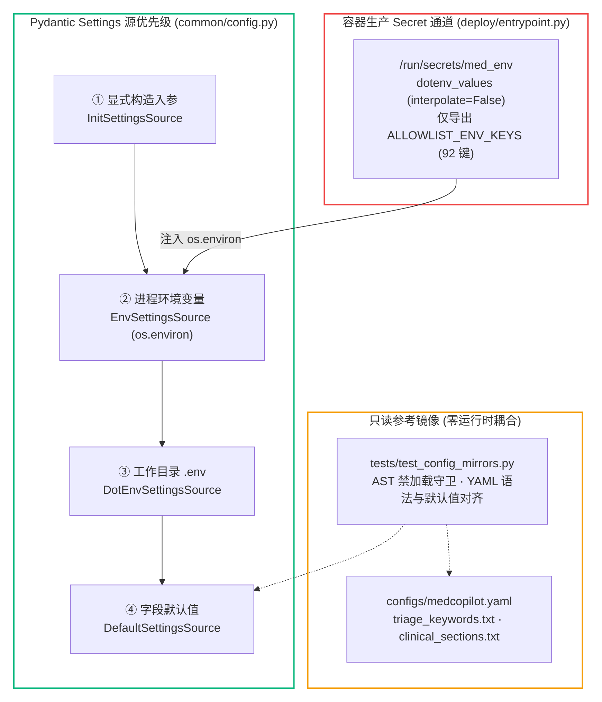
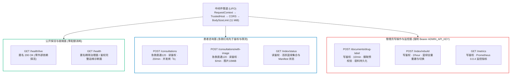
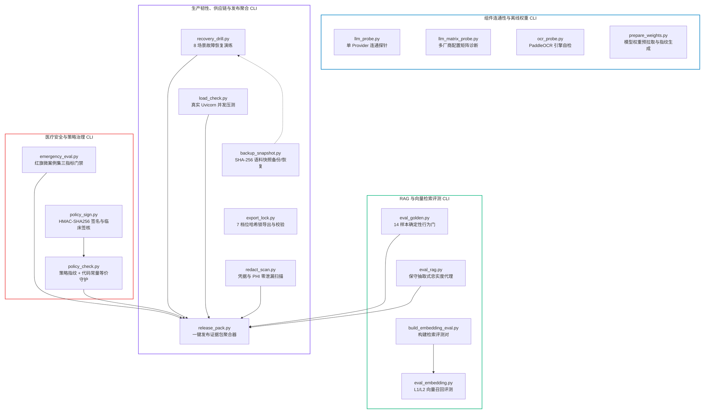

# HTTP API、CLI 脚本与 92 项配置全量参考手册（API, CLI & Configuration Reference）

本文档提供 `medcopilot` 中配置系统（全量 92 项 `AppConfig` 环境变量与只读镜像 `configs/medcopilot.yaml`）
、FastAPI 服务端全部 8 个 HTTP 端点与 Prometheus 指标，
以及 `scripts/` 下全部 17 个运维与评测 CLI 脚本的参数签名、默认值、
校验规则与退出码规范。

---

## 1. 配置体系边界与全量 92 项 `AppConfig` 参数字典

### 1.1 配置加载优先级与容器白名单架构图

**图 1　配置加载优先级与容器 92 键白名单架构**

`AppConfig`（`common/config.py:10-204`）
启用 `validate_assignment=True` 与 `extra="ignore"`，
其 92 个字段与 `deploy/entrypoint.py:ALLOWLIST_ENV_KEYS` 的集合相等性由 `tests/test_deploy_contract.py::TestEntrypointContract::test_allowlist_is_exactly_the_appconfig_aliases` 强制锁定。

### 1.2 全局、日志与医疗审计配置（10 项）

**表 1　全局、日志与医疗审计配置（10 项）**

| 环境变量名 (`alias`) | `AppConfig` 字段名 | 类型 | 默认值 | 校验规则与语义说明 |
| :--- | :--- | :--- | :--- | :--- |
| `PROJECT_ENV` | `project_env` | `str` | `""` | **W1.3 默认拒绝**：仅 `development`/`dev`/`test`/`local` 开放开发默认行为；`production`/`prod` 为生产模式；空值或拼写错误（如 `prodction`）对普通读写一律返回 HTTP 503 |
| `LOG_LEVEL` | `log_level` | `str` | `"INFO"` | 经 `_normalize_log_level` 校验：自动大写归一、空串回退 `"INFO"`、`"WARN"` 归一为 `"WARNING"`；仅允许 `TRACE`/`DEBUG`/`INFO`/`SUCCESS`/`WARNING`/`ERROR`/`CRITICAL` |
| `LOG_FORMAT` | `log_format` | `Literal["human", "json"]` | `"human"` | `"human"` 为彩色终端输出；`"json"` 为单行 JSON 结构化日志（携带 `request_id` 并经 `redact_log` 脱敏） |
| `APP_VERSION` | `app_version` | `str` | `"2.0.0"` | `/health` 与 `/metrics` 暴露的应用版本号 |
| `APP_GIT_SHA` | `app_git_sha` | `str` | `"unknown"` | 容器构建或部署注入的 Git commit SHA |
| `LOG_FILE` | `log_file` | `str` | `"logs/app.log"` | 应用日志轮转文件路径（10 MB 轮转，保留 7 天）；设为空串 `""` 时禁用文件 sink |
| `AUDIT_LOG_PATH` | `audit_log_path` | `str` | `"logs/audit.jsonl"` | 医疗合规审计日志路径（追加式 JSONL + SHA-256 哈希链，免 PHI）；生产环境必填 |
| `AUDIT_RETENTION_DAYS` | `audit_retention_days` | `int` | `2190` | 审计保留天数（默认 6 年，对齐 45 CFR §164.316(b)(2)(i)） |
| `AUDIT_FSYNC` / `AUDIT_NTP_SERVER` | `audit_fsync` / `audit_ntp_server` | `bool` / `str` | `False` / `""` | 逐条审计写入是否强制 `os.fsync`；可选 SNTP 服务器地址（启动探测时钟偏移 `audit_time_offset_ms`） |

### 1.3 医疗安全门、保护槽、充分性门与入库校验配置（15 项）

**表 2　医疗安全门、保护槽、充分性门与入库校验配置（15 项）**

| 环境变量名 (`alias`) | `AppConfig` 字段名 | 类型 | 默认值 | 校验规则与语义说明 |
| :--- | :--- | :--- | :--- | :--- |
| `DOSAGE_GATE_MODE` | `dosage_gate_mode` | `str` | `"redact"` | 剂量门模式：`redact`（默认，剥离指令性剂量并转介医嘱）、`quote`（仅在安全章节在场且逐字匹配原文时放行）、`off`（仅限开发环境，生产环境构造即抛 `ValueError`） |
| `RETRIEVE_CANDIDATE_POOL` | `retrieve_candidate_pool` | `int` | `20` | `ContraindicationTrigger` 触发安全语境时的检索候选池扩容大小 |
| `EVIDENCE_TOP_N` | `evidence_top_n` | `int` | `5` | 最终送入重排与 Prompt 装配的证据分块上限 |
| `SAFETY_RESERVE_SLOTS` | `safety_reserve_slots` | `int` | `2` | 触发安全语境时在 `EVIDENCE_TOP_N` 中强制预留给【禁忌/相互作用/注意事项】等安全章节的保底槽位数 |
| `SAFETY_SECTION_GATE_ENABLED` | `safety_section_gate_enabled` | `bool` | `True` | 触发安全语境但最终证据缺失安全章节时是否强制弃答 |
| `SUFFICIENCY_ENABLED` | `sufficiency_enabled` | `bool` | `True` | 是否启用 `SufficiencyGate` 锚点覆盖率判据 |
| `SUFFICIENCY_MIN_DOC_COVERAGE` | `sufficiency_min_doc_coverage` | `float` | `0.10` | 单篇证据分块的最低提问锚点覆盖率 $\operatorname{cov}_{\text{doc}}$ |
| `SUFFICIENCY_MIN_UNION_COVERAGE` | `sufficiency_min_union_coverage` | `float` | `0.20` | 全部召回证据并集的最低提问锚点覆盖率 $\operatorname{cov}_{\text{union}}$ |
| `SUFFICIENCY_DRY_RUN` | `sufficiency_dry_run` | `bool` | `True` | 影子模式：为 `True` 时仅记录 `sufficiency:{reason}` 降级原因而不阻断回答；置 `False` 时直接弃答 |
| `EVIDENCE_FLOOR` | `evidence_floor` | `float` | `0.05` | 历史兼容字段（已由 `SufficiencyGate` 替代，不再参与硬门控） |
| `GROUNDEDNESS_THRESHOLD` | `groundedness_threshold` | `float` | `0.15` | `MedicalSafetyGuard` 回答与证据的最低字符重叠率阈值 |
| `MAX_DRUG_LABEL_CHARS` | `max_drug_label_chars` | `int` | `50000` | `/documents/drug-label` 单份说明书最大字符数（超出返回 HTTP 413） |
| `INGEST_VALIDATION_ENABLED` | `ingest_validation_enabled` | `bool` | `True` | 是否启用 `/documents/drug-label` 摄取前置校验闸门 `IngestValidator` |
| `INGEST_MIN_RAW_CHARS` | `ingest_min_raw_chars` | `int` | `30` | 无标题纯文本说明书的最小字符数门槛（带标准章节标题的短标签门槛为 10 字符） |
| `INGEST_MAX_LINE_CHARS` | `ingest_max_line_chars` | `int` | `4000` | 摄取说明书单行最大允许字符数（防 base64/二进制 blob 注入） |

### 1.4 API 鉴权、CORS、限流、并发闸、会话与语料存储配置（16 项）

**表 3　API 鉴权、CORS、限流、并发闸、会话与语料存储配置（16 项）**

| 环境变量名 (`alias`) | `AppConfig` 字段名 | 类型 | 默认值 | 校验规则与语义说明 |
| :--- | :--- | :--- | :--- | :--- |
| `ADMIN_API_KEY` | `admin_api_key` | `str \| None` | `None` | Bearer 访问令牌；生产环境未设置时所有非急救读写接口一律 503（fail-closed） |
| `CORS_ORIGINS` | `cors_origins` | `str` | `"http://127.0.0.1:7860,..."` | 逗号分隔的允许跨域前端源列表 |
| `CORS_ALLOW_ALL` | `cors_allow_all` | `bool` | `False` | 仅限本地调试：置 `True` 时允许 `*` 源但强制置 `allow_credentials=False` |
| `MED_TRUSTED_HOSTS` | `trusted_hosts` | `str` | `"*"` | `TrustedHostMiddleware` 白名单（逗号分隔）；生产环境应固定为对外域名 |
| `MED_API_BASE_URL` | `med_api_base_url` | `str` | `"http://127.0.0.1:8000"` | Gradio UI 客户端连接 FastAPI 的基地址 |
| `MED_API_TIMEOUT_SECONDS` | `med_api_timeout_seconds` | `float` | `30.0` | Gradio UI 客户端请求超时秒数 |
| `MED_SESSION_TTL_SECONDS` | `med_session_ttl_seconds` | `float` | `1800.0` | `gt=0`；进程内有界 LRU 会话存储的滑动过期秒数 |
| `MED_SESSION_MAX_ENTRIES` | `med_session_max_entries` | `int` | `256` | `gt=0`；最大并发存活会话数（满载且无过期项可驱逐时新会话返回 503） |
| `MED_CORPUS_PATH` | `med_corpus_path` | `str` | `""` | 权威语料 JSONL 持久化路径；留空为纯内存模式 |
| `SAFETY_POLICY_PATH` | `safety_policy_path` | `str` | `"medcopilot/datasets/policies/safety_policy_v1.json"` | 医疗安全策略审计镜像 JSON 路径 |
| `MED_RATE_LIMIT_ENABLED` | `rate_limit_enabled` | `bool` | `True` | 是否启用按身份/IP 的滑动窗口限流器 |
| `MED_RATE_LIMIT_CONSULT_PER_MINUTE` | `rate_limit_consult_per_minute` | `int` | `20` | `gt=0`；`/consultations` 每分钟配额（急救提问永不限流） |
| `MED_RATE_LIMIT_IMAGE_PER_MINUTE` | `rate_limit_image_per_minute` | `int` | `6` | `gt=0`；`/consultations/with-image` 每分钟配额 |
| `MED_RATE_LIMIT_INGEST_PER_MINUTE` | `rate_limit_ingest_per_minute` | `int` | `10` | `gt=0`；`/documents/drug-label` 每分钟配额 |
| `MED_RATE_LIMIT_REBUILD_PER_HOUR` | `rate_limit_rebuild_per_hour` | `int` | `2` | `gt=0`；`/index/rebuild` 每小时配额 |
| `MED_LLM_CONCURRENCY` | `llm_concurrency` | `int` | `8` | `gt=0`；检索+重排+OCR+LLM 重路径最大并发在途数（超出立即 503） |

### 1.5 四大模型能力（LLM / OCR / Embedding / Reranker）本地与云端配置（51 项）

**表 4　四大模型能力本地与云端配置（51 项）**

| 能力域 | 环境变量名 (`alias`) | `AppConfig` 字段名 | 类型与约束 | 默认值 | 说明 |
| :--- | :--- | :--- | :--- | :--- | :--- |
| **出网总闸** | `ALLOW_TEXT_EGRESS` | `allow_text_egress` | `bool` | `False` | 文本出网许可（LLM/Embedding/Reranker 设为 `cloud` 时必须显式置 `True`） |
| **出网总闸** | `ALLOW_IMAGE_EGRESS` | `allow_image_egress` | `bool` | `False` | 图片出网许可（`OCR_PROVIDER=cloud` 时必须显式置 `True`） |
| **LLM** | `LLM_MODE` | `llm_mode` | `Literal["local", "cloud"]` | `"local"` | 默认 `local`（Mock 或本机 `localhost`/`127.0.0.1`/`::1`/`ollama`）；远端调用须显式设 `cloud` |
| **LLM** | `LLM_PROVIDER` | `llm_provider` | `str` | `"openai_compatible"` | 支持 `openai_compatible`、`qianfan`、`zhipu`、`mock` |
| **LLM** | `LLM_API_BASE` / `LLM_API_KEY` / `LLM_MODEL` | `llm_api_base` / `llm_api_key` / `llm_model` | `str` | `"https://api.openai.com/v1"` / `""` / `"gpt-4o-mini"` | OpenAI 兼容端点、密钥与模型名 |
| **LLM** | `QIANFAN_AK` / `QIANFAN_SK` / `ZHIPUAI_API_KEY` | `qianfan_ak` / `qianfan_sk` / `zhipuai_api_key` | `str \| None` | `None` | 百度文心千帆与智谱 AI 专有凭据 |
| **LLM** | `LLM_TEMPERATURE` / `LLM_MAX_TOKENS` | `llm_temperature` / `llm_max_tokens` | `float` / `int (gt=0)` | `0.2` / `2048` | 生成温度与最大输出 Token |
| **LLM** | `LLM_TIMEOUT` / `LLM_MAX_ATTEMPTS` | `llm_timeout` / `llm_max_attempts` | `float (gt=0)` / `int (gt=0)` | `60.0` / `3` | 单次 HTTP 超时秒数与最大总尝试次数 |
| **LLM** | `LLM_BACKOFF_BASE` / `LLM_BACKOFF_CAP` / `LLM_RETRY_DEADLINE` | `llm_backoff_base` / `llm_backoff_cap` / `llm_retry_deadline` | `float` | `1.0` / `20.0` / `45.0` | Full-jitter 指数退避基数、单次退避上限与总重试时间预算（秒） |
| **LLM** | `MOCK_LLM` / `ALLOW_MOCK_IN_PRODUCTION` | `mock_llm` / `allow_mock_in_prod` | `bool` | `False` / `False` | 离线结构化 Mock 开关与生产环境允许 Mock 显式逃生阀 |
| **预算** | `MED_LLM_PROMPT_TOKEN_BUDGET` / `MED_LLM_EVIDENCE_TOKEN_BUDGET` / `MED_LLM_CHUNK_TOKEN_CAP` | `llm_prompt_token_budget` / `llm_evidence_token_budget` / `llm_chunk_token_cap` | `int (gt=0)` | `3500` / `2200` / `1200` | Prompt 总预算、证据总预算与单块上限 |
| **OCR** | `OCR_PROVIDER` | `ocr_provider` | `Literal["local", "cloud"]` | `"local"` | 默认本地 PaddleOCR；`cloud` 走 OpenAI Vision 多模态接口 |
| **OCR** | `OCR_API_BASE` / `OCR_API_KEY` / `OCR_API_MODEL` / `OCR_API_TIMEOUT` | `ocr_api_base` / `ocr_api_key` / `ocr_api_model` / `ocr_api_timeout` | `str` / `float (gt=0)` | `""` / `""` / `""` / `30.0` | 云端视觉 OCR 端点、密钥、模型与超时 |
| **OCR** | `MED_OCR_MAX_LINES` / `MED_OCR_MAX_LINE_CHARS` | `ocr_max_lines` / `ocr_max_line_chars` | `int (gt=0)` | `5` / `120` | 送入检索与 Prompt 的药盒 OCR 最大行数与单行字符上限 |
| **Embedding** | `ENABLE_CHROMA_DENSE` / `CHROMA_PERSIST_DIRECTORY` | `enable_chroma_dense` / `chroma_persist_directory` | `bool` / `str` | `False` / `"./data/chroma_db"` | 是否启用 Chroma 稠密检索及持久化目录 |
| **Embedding** | `EMBEDDING_PROVIDER` / `EMBEDDING_MODEL` | `embedding_provider` / `embedding_model` | `Literal["local", "cloud"]` / `str` | `"local"` / `"BAAI/bge-m3"` | 默认本地 `MedBgeM3EmbeddingFunction`；`cloud` 走 `ApiEmbeddingFunction` |
| **Embedding** | `EMBEDDING_DIM` / `EMBEDDING_BATCH_SIZE` / `EMBEDDING_NORMALIZE` / `EMBEDDING_CACHE_DIR` | `embedding_dim` / `embedding_batch_size` / `embedding_normalize` / `embedding_cache_dir` | `int` / `bool` / `str` | `1024` / `16` / `True` / `""` | 向量维度、批大小、L2 归一化与本地缓存目录 |
| **Embedding** | `EMBEDDING_API_BASE` / `EMBEDDING_API_KEY` / `EMBEDDING_API_TIMEOUT` | `embedding_api_base` / `embedding_api_key` / `embedding_api_timeout` | `str` / `float (gt=0)` | `""` / `""` / `30.0` | 云端 `/embeddings` 端点、密钥与超时 |
| **Reranker** | `RERANK_ENABLED` / `RERANK_PROVIDER` / `RERANKER_MODEL` | `rerank_enabled` / `rerank_provider` / `reranker_model` | `bool` / `Literal["local", "cloud"]` / `str` | `True` / `"local"` / `"BAAI/bge-reranker-base"` | 重排总开关、本地/云端模式与模型名 |
| **Reranker** | `RERANK_TOP_N` / `RERANK_MAX_LENGTH` / `RERANK_CACHE_DIR` / `RRF_K` | `rerank_top_n` / `rerank_max_length` / `rerank_cache_dir` / `rrf_k` | `int` / `str` | `3` / `512` / `""` / `60` | 重排保留数、最大序列长度、缓存目录与 RRF 平滑常数 |
| **Reranker** | `RERANK_API_BASE` / `RERANK_API_KEY` / `RERANK_API_TIMEOUT` | `rerank_api_base` / `rerank_api_key` / `rerank_api_timeout` | `str` / `float (gt=0)` | `""` / `""` / `30.0` | 云端 `/rerank` 端点、密钥与超时 |
| **离线锁** | `MODEL_WEIGHTS_OFFLINE` | `model_weights_offline` | `bool` | `True` | 强制本地模型加载传入 `local_files_only=True`，禁止运行期联网下载权重 |

---

## 2. FastAPI HTTP 端点与 Prometheus 指标契约（`api/server.py`）

### 2.1 HTTP 端点鉴权、限流与并发闸路由拓扑图

**图 2　FastAPI HTTP 端点鉴权、限流与并发闸路由拓扑**

### 2.2 HTTP 端点一览表

**表 5　FastAPI HTTP 端点契约**

| 方法与路径 | 鉴权要求 | 限流配额 | 请求体 / 参数 | 成功与错误状态码契约 |
| :--- | :--- | :--- | :--- | :--- |
| `GET /health/live` | 匿名公开 | 不限流 | 无 | `200 OK`：`{"status": "alive", "uptime_seconds": float}`（零外部依赖，供容器 `HEALTHCHECK` 探活） |
| `GET /health` | 匿名返回精简探活面；携带有效 Bearer（或开发无密钥开放模式）返回完整运维诊断面 | 不限流 | 可选 `Authorization: Bearer <ADMIN_API_KEY>` | `200 OK`：核心面含 `status`、`auth_required`、`env_class`、`env_recognized` 及策略治理字段；完整面额外包含 `corpus_*`、`index_*`、`rerank_*`、`llm_*`、`ocr_*`、`audit_*`、`components`（其内含 `abuse_controls` 防滥用计数，防 OWASP API8 信息枚举） |
| `GET /metrics` | 强制 `require_admin`（Bearer `ADMIN_API_KEY`） | 不限流 | `Authorization: Bearer <ADMIN_API_KEY>` | `200 OK`（`text/plain; version=0.0.4` Prometheus 指标文本）；未配置密钥返回 `503`（或开发无密钥开放模式，同 `/health`），缺/错令牌返回 `401` |
| `POST /consultations` | **急救提问免鉴权直通 120**；普通提问需 `require_reader` | `20 / min`（急救不限流） | JSON: `{"query": str, "session_id": str \| None}`（OCR 药名上下文由服务端自行构造，非客户端入参） | `200 OK`（`ConsultationResponse`）；超 11 MiB 返回 `413`；非急救超 2000 字符或空提问返回 `422`；未知/过期会话返回 `404`；限流返回 `429`；并发闸满或环境未就绪返回 `503` |
| `POST /consultations/with-image` | **急救提问免鉴权直通 120**；普通提问需 `require_reader` | `6 / min`（急救不限流） | Multipart Form: `query` (`str`), `image` (`UploadFile`, $\le 10\text{ MiB}$, 校验 JPEG/PNG/BMP/WebP 魔数字节), `session_id` (`str \| None`) | `200 OK`（含 `ocr_status`；OCR 行与匹配药名仅并入服务端构造的上下文，不作为响应字段）；非法扩展名或魔数不符返回 `400`；图片或请求体超限返回 `413` |
| `POST /documents/drug-label` | 强制 `require_admin` | `10 / min` | Form: `raw_text` (`str`), `drug_name` (`str`) | `200 OK`：`{"drug_name", "chunks_added", "chunks_replaced", "corpus_size"}`；预校验未通过或空药名返回 `422`；超 `MAX_DRUG_LABEL_CHARS` 返回 `413`；语料写盘失败返回 `500` |
| `POST /index/rebuild` | 强制 `require_admin` | `2 / hour` | 无 | `200 OK`（返回新 `manifest`）；未启用稠密检索或持久化语料返回 `400`；并发重建/摄取冲突或哈希分歧返回 `409`；构建校验失败回滚并返回 `500` |
| `GET /index/status` | `require_reader` | 不限流 | 可选 Bearer | `200 OK`：`{"manifest", "manifest_status", "manifest_error", "pin_verified", "dense_available", "active_collection", "corpus_matches_index"}` |

---

## 3. 17 个运维与评测 CLI 脚本全量参考（`scripts/*.py`）

### 3.1 17 个 CLI 脚本分类与协同关系图

**图 3　17 个运维与评测 CLI 脚本分类协同**

### 3.2 CLI 脚本参数与退出码详表

所有脚本均内置 `sys.path` 仓库根自举（或为纯标准库自足脚本），
支持在仓库根目录或 `medcopilot/` 目录下执行：

**表 6　运维与评测 CLI 脚本参数与退出码契约**

| 脚本路径 | 核心用途 | 关键 CLI 参数与默认值 | 退出码契约 |
| :--- | :--- | :--- | :--- |
| `scripts/eval_golden.py` | 版本化 RAG 金标集确定性行为门 | `--golden datasets/eval/rag_golden_v1.jsonl` `--failures-out reports/golden_failures.jsonl` `--report-out` (可选 JSON 报告路径) | `0` = 全部 14 条金标样本通过； `1` = 存在失败样本 |
| `scripts/emergency_eval.py` | 急救红旗词表召回率/误报率/降级率门禁 | `--dataset datasets/eval/emergency_vignettes_v1.jsonl` `--json` (可选 JSON 输出路径) | `0` = 满足 Recall $\ge 1.0$、FPR $\le 0.05$、Demotion $\ge 1.0$； `1` = 任一指标未达标 |
| `scripts/policy_check.py` | 安全策略工件签名、评审门与代码常量等价守护 | `--policy datasets/policies/safety_policy_v1.json` `--require-signature` / `--require-signoff`（签名密钥经环境变量 `POLICY_SIGNING_KEY` 读取） | `0` = 通过；`1` = 指纹/评审/代码等价失败；`2` = 工件缺失或格式非法；`3` = 缺有效签名；`4` = 缺临床签核 |
| `scripts/policy_sign.py` | 安全策略工件 HMAC-SHA256 签名与临床签核 CLI | 子命令：`sign`、`verify`、`start-signoff`、`approve-signoff` `--signed-by`（sign）/ `--reviewer` + `--credentials`（签核） | `0` = 签名/验签/签核成功； `1` = 验签失败或密钥缺失 |
| `scripts/recovery_drill.py` | 8 场景故障恢复与失败封闭演练 | `--output outputs/recovery_drill.json` | `0` = 全部 8 个场景 `passed=True`；`1` = 任一场景失败 |
| `scripts/load_check.py` | 启动真实 Uvicorn 子进程执行并发压测 | `--concurrency 8`、`--requests-per-worker 5` `--output outputs/load_report.json` | `0` = 服务就绪且 `errors == 0`； `1` = 启动超时或存在失败请求 |
| `scripts/backup_snapshot.py` | 权威语料与 Manifest 的 SHA-256 快照备份/校验/恢复 | 子命令：`create <src> <dst>`、`verify <snap>`、`restore <snap> <target> [--dry-run]`、`backup --corpus <src> --dest <dst>`（定时任务入口，publish 后自动按保留策略清理） | `0` = 成功且校验通过； `1` = 哈希不符或路径非法；`2` = 参数错误 |
| `scripts/export_lock.py` | 从 `uv.lock` 导出带哈希的 `requirements*.lock.txt` | `--profile {base,ci,rag,eval,ocr,build,tools}` `--check`（仅校验同步性不写盘）、`--output` | `0` = 导出成功或 `--check` 一致； `1` = 锁文件过期不一致 |
| `scripts/redact_scan.py` | 发布产物与日志的凭据/Bearer/PHI 静态扫描 | `<path>`（位置参数，默认 `outputs`） | `0` = 零泄漏发现且目标路径存在； `1` = 检出未脱敏凭据/PHI 或目标路径缺失 |
| `scripts/release_pack.py` | 聚合 11 项门禁子进程生成发布证据包 | `--profile {opensource,production}` `--only <comma_gates>`、`--output outputs/release_pack.json` | `0` = `overall == "pass"`； `1` = `fail` / `incomplete` / `engineering_pass_clinical_blocked` |
| `scripts/eval_rag.py` | 保守抽取式词法忠实度与相关性评测代理 | `--suite <json>`、`--threshold-faithfulness 0.7`、`--threshold-context 0.5` | `0` = 达标；`1` = 未达标（默认 Mock 下按设计退出 `1`） |
| `scripts/build_embedding_eval.py` | 从金标语料构建确定性 Embedding 评测对 | `--corpus datasets/eval/rag_golden_v1.jsonl` `--target datasets/eval/embedding_pairs_v1.jsonl` | `0` = 生成成功且对数 $\ge 50$（`MIN_PAIRS`） |
| `scripts/eval_embedding.py` | 稠密向量编码器 L1/L2 召回评测 | `--encoder {auto,dense,api,synthetic}`、`--pipeline` `--no-gate`、`--output` | `0` = 达标或未启用稠密检索跳过（`skip`）； `1` = 指标未达标或 API 未配置 |
| `scripts/llm_probe.py` | 单 Provider LLM 连通性与鉴权探针 | `--provider/--api-base/--api-key/--model`、`--timeout-seconds 15.0` `--output outputs/llm_probe.json` | `0` = `ok`；`1` = 鉴权/网络失败；`2` = `not-configured`（Mock 或缺密钥） |
| `scripts/llm_matrix_probe.py` | 多 Provider（OpenAI/千帆/智谱）矩阵诊断 | `--providers <csv>`、`--timeout-seconds 15`、`--output`（始终输出 JSON 摘要） | `0` = 矩阵诊断完成 |
| `scripts/ocr_probe.py` | 本地 PaddleOCR 引擎可用性与推理自检 | `--image` (可选测试图片路径)、`--output` | `0` = 引擎可用；`2` = 引擎未安装或不可用 |
| `scripts/prepare_weights.py` | 容器构建期预拉取模型权重并写 SHA-256 指纹 | `--cache-dir /opt/hf-cache` `--fingerprint /opt/hf-cache/weights_fingerprint.json` | `0` = 权重拉取并生成指纹成功；`1` = 失败 |
