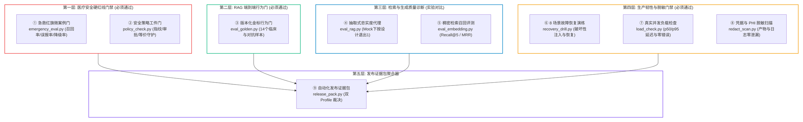
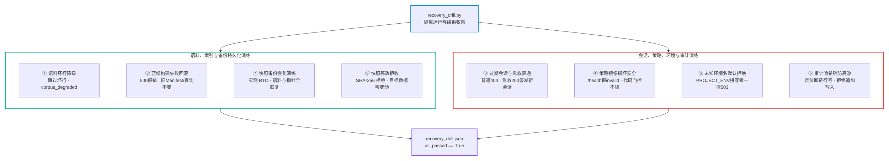
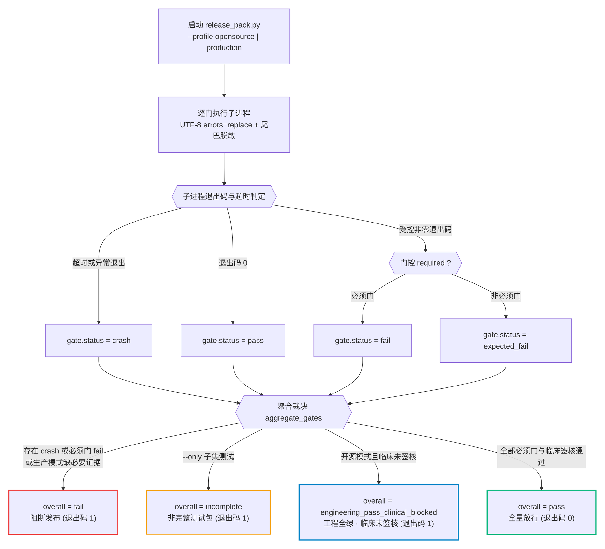

# 评测基准、故障恢复演练与发布门禁规范（Evaluation Benchmarks, Recovery Drills & Release Gates）

本文档定义 `medcopilot` 的五层工程与医疗安全验证体系：
**版本化 RAG 金标确定性行为门**、**急救红旗微案例验收集**、
**保守抽取式词法评测代理与同义改写探针**、**稠密向量检索评测套件**，
以及**8 场景故障恢复演练与发布证据包（`release_pack.py`）聚合协议**。

> **重要合规声明**：本体系中的所有门禁、
> 指标与恢复演练仅证明**软件工程契约、确定性护栏行为与可复现性**，
> 不构成临床有效性证明或医疗器械认证。
> 在 `safety_policy_v1.json` 的 `clinical_signoff.status` 未由具备执业资质的临床医师/药师签署为 `"approved"` 前，
> 发布证据包恒阻断生产放行（`engineering_pass_clinical_blocked`）。

---

## 五层评测与发布门禁总览

**图 1　五层评测与发布门禁总览**

---

## 1. 版本化 RAG 金标集确定性行为门（`evaluation/golden_eval.py` & `scripts/eval_golden.py`）

`evaluation/golden_eval.py` 通过 `load_golden_dataset` 加载版本化金标集 `datasets/eval/rag_golden_v1.jsonl`（JSONL 工件本身即版本化契约：
`1` 条 `meta` 版本头 + `3` 条 `corpus` 简化教学标签 + `14` 条 `case` 临床样本），
再由 `run_golden` 对每条用例驱动隔离的 `ClinicalChunker -> HybridRetriever -> Reranker -> AgentGraph` 管线，
按 `kind` 分三类契约判定：

**表 1　金标集三类用例契约（kind × expect 字段）与判定语义**

| 用例类型 (`kind`) | 期望字段 (`expect`) | 判定语义 |
| :--- | :--- | :--- |
| `retrieval` | `hit_drug`（str）+ `hit_sections`（list） | 药品名称与临床章节必须命中默认 `top_k = 3` 的检索结果 |
| `routing` | `intent` ∈ {`emergency`, `non_medical`, `medical`}（急救用例附加断言 `is_emergency`） | 分诊路由意图与金标一致；急救红线必须短路 |
| `abstention` | `abstained`（bool） | 无据/越界/低重叠提问必须安全弃答 |

- **结果对象**：`CaseResult{case_id, kind, question, passed, expected, actual}`；
`GoldenReport.summary()` 输出总数/通过数/`retrieval_hit_rate`。
- **失败样本闭环**：
`write_failure_samples` 将失败用例（question + expectation + retrieval/routing actuals）
**覆盖写入** `--failures-out`（默认 `reports/golden_failures.jsonl`），
作为下一轮迭代的可重放输入，并以退出码 `1` 阻断 CI。

---

## 2. 急救红旗微案例验收集（`scripts/emergency_eval.py`）

`scripts/emergency_eval.py` 针对 `datasets/eval/emergency_vignettes_v1.jsonl`（涵盖急性心脑血管、
FAST-120 无关键词卒中描述、雷击样头痛、高血压危象伴症状、服药过量、自伤、
产科出血、呼吸困难、病程演进型急症，
以及常规用药良性提问和既往史/影视/考题叙事样本）
逐条调用 `EmergencyDetector.evaluate(query, source="user_query")`，
分别计算以下三项指标：

1. **红旗急症召回率（Red-Flag Recall）**：

$$
\operatorname{Recall}_{\text{red-flag}} = \frac{\text{TP}_{\text{emergency}}}{\text{TP}_{\text{emergency}} + \text{FN}_{\text{emergency}}} \tag{1}
$$

式中：
- $\text{TP}_{\text{emergency}}$、
$\text{FN}_{\text{emergency}}$ —— 急救微案例集中被正确判定/漏判为非急症的样本数。

2. **良性咨询误报率（Benign False-Positive Rate）**：

$$
\operatorname{FPR}_{\text{benign}} = \frac{\text{FP}_{\text{benign}}}{\text{FP}_{\text{benign}} + \text{TN}_{\text{benign}}} \tag{2}
$$

式中：
- $\text{FP}_{\text{benign}}$、
$\text{TN}_{\text{benign}}$ —— 良性用药咨询被误触发/正确放行的样本数。

3. **病史与叙事样本降级准确率（Narrative Demotion Accuracy）**：

$$
\operatorname{Acc}_{\text{demotion}} = \frac{N_{\text{demoted\_correctly}}}{N_{\text{narrative\_total}}} \tag{3}
$$

式中：
- $N_{\text{demoted\_correctly}}$ —— 叙事/病史样本中被正确降级为非急症的数量；
- $N_{\text{narrative\_total}}$ —— 叙事样本总数。

- **硬门禁阈值**（`emergency_eval.py:57-59` 默认值与数据集门禁）：

$$
\operatorname{Recall}_{\text{red-flag}} \ge 1.0 \tag{4}
$$

$$
\operatorname{FPR}_{\text{benign}} \le 0.05 \tag{5}
$$

$$
\operatorname{Acc}_{\text{demotion}} \ge 1.0 \tag{6}
$$

式中：
- 三项指标定义见式(1)~(3)；
- 阈值 1.0 / 0.05 / 1.0 为 emergency_eval.py 第 57-59 行的默认硬门禁。

---

## 3. 保守抽取式词法评测代理（`scripts/eval_rag.py` & `evaluation/rag_official_adapter.py`）

### 3.1 抽取式忠实度与上下文相关度数学定义

`scripts/eval_rag.py` 不依赖外部评审 LLM，提供严苛的离线抽取式下界估计：

1. **来源范围锁定（`_resolve_evidence_texts`）**：
仅认可本次运行返回的 `sources[*].chunk_id` 在本例真实分块字典中查到的原文；
忽略未知 `chunk_id` 或 `sources` 自带的文本。
2. **抽取式整句忠实度（`evaluate_faithfulness`）**：
   将模型回答按句末标点切分为非空句子集合 $S(a) = \{s_1, \dots, s_m\}$。
若回答属于拒答、弃答、Mock 占位、系统错误或仅含免责声明，则忠实度得分为 $0$；
否则：

$$
\operatorname{Faithfulness}(a, \mathcal{E}) = \frac{1}{\lvert S(a) \rvert} \sum_{s \in S(a)} \mathbb{I}\big[\operatorname{norm}(s) \in \operatorname{NormSent}(\mathcal{E}) \;\land\; \lvert s \rvert \ge 4 \;\land\; \neg\operatorname{Disclaimer}(s)\big] \tag{7}
$$

式中：
- $S(a)$ —— 回答 $a$ 按句末标点切分的句子集合（全部计入分母）；
- $\operatorname{NormSent}(\mathcal{E})$ —— 证据句归一化集合（剥离合成药名/章节头后）；
- $\operatorname{norm}(s) \in \operatorname{NormSent}(\mathcal{E})$ —— **整句相等**（集合隶属，
不是子串包含）；
- $\lvert s \rvert \ge 4$ —— 短句过滤；
- $\operatorname{Disclaimer}(s)$ —— 免责声明正则 `_DISCLAIMER` 命中；
- 弃答/拒答/急救/非医疗与 `_NONANSWER` 命中的回答整体计 $0$ 分。

3. **词法上下文相关度（`evaluate_context_relevance`）**：
   设提问 $q$ 的非空白词元/汉字集合为 $T(q)$，
已锁定证据文本拼接的词元/汉字集合为 $T(\mathcal{E})$，则词法覆盖相关度为：

$$
\operatorname{ContextRelevance}(q, \mathcal{E}) = \frac{\lvert T(q) \cap T(\mathcal{E}) \rvert}{\lvert T(q) \rvert} \tag{8}
$$

式中：
- $T(q)$ —— 提问 $q$ 的非空白词元/汉字集合；
- $T(\mathcal{E})$ —— 证据拼接文本的词元/汉字集合。

   其中免责声明句保留在 $\operatorname{Faithfulness}$ 的分母 $\lvert S(a) \rvert$ 中但不计入分子得分。
因此，
默认 `MOCK_LLM=1` 下 `eval_rag.py` 的忠实度恒为 `0.0` 并以退出码 `1` 结束——这是**刻意设计的诚实失败（`expected_fail`）**，
防止用模拟输出或免责套话伪造“生成质量达标”。
4. **可选官方评测框架适配器（`evaluation/rag_official_adapter.py`）**：
   提供 `Ragas` 与 `DeepEval` 的可选惰性适配入口（安装 `.[eval]` 后可用），
用于开发期实验对比，不进入核心 serving 路径。

---

## 4. 稠密向量检索评测套件（`scripts/build_embedding_eval.py` & `scripts/eval_embedding.py`）

针对中文药品说明书检索质量，
`eval_embedding.py` 在 `datasets/eval/embedding_pairs_v1.jsonl`（涵盖 `canonical` 规范提问、
`synonym` 口语同义提问与 `weak-hint` 弱提示提问，并标注 `safety_critical`）
上执行两级评测：

1. **L1 编码器前 $k$ 召回率（$\operatorname{Recall@}k$）**：

$$
\operatorname{Recall@}k = \frac{1}{\lvert Q \rvert} \sum_{q \in Q} \mathbb{I}\big[\text{gold\_chunk\_id}(q) \in \operatorname{Top}_k(q)\big] \tag{9}
$$

式中：
- $Q$ —— 评测问题集合；
- $\text{gold\_chunk\_id}(q)$ —— 问题 $q$ 的标准答案分块；
- $\operatorname{Top}_k(q)$ —— 编码器余弦检索的前 $k$ 结果。

2. **L1 平均倒数排名（$\operatorname{MRR@}5$）**：

$$
\operatorname{MRR@}5 = \frac{1}{\lvert Q \rvert} \sum_{q \in Q} \frac{\mathbb{I}[\operatorname{rank}(q) \le 5]}{\operatorname{rank}(q)} \tag{10}
$$

式中：
- $\operatorname{rank}(q)$ —— 标准答案分块在检索结果前 5 名中的排名（排名窗口即 `ranking[:5]`）；
- 未命中时分子指示函数置 $0$（该问题贡献 $0$，不产生除零）。

3. **L2 真实 HybridRetriever 管线分解（`rank_via_pipeline`）**：
   注入被测稠密编码器运行完整的 `HybridRetriever(BM25 + Dense + RRF)`，
分别输出按提问风格（`by_style`）和按安全关键性（`by_safety`）
分层的 `Recall@5`。
4. **门禁阈值（`THRESHOLDS`，`scripts/eval_embedding.py:45-51`）**：
`recall_at_1 >= 0.60`、`recall_at_3 >= 0.85`、`recall_at_5 >= 0.90`、
`mrr_at_5 >= 0.75`、`safety_recall_at_5 >= 0.90`。
当默认未启用稠密检索且未指定编码器时，
脚本诚实输出 `status="skip"` 并退出 `0`。

---

## 5. 8 场景自动化故障恢复演练（`scripts/recovery_drill.py`）

### 5.1 八大故障注入与自愈/失败封闭验证全景图

**图 2　八场景故障注入与自愈/失败封闭演练全景**

### 5.2 八场景演练契约对照表

**表 2　八场景故障恢复演练契约对照**

| 场景编号与标识符 (`scenario`) | 故障注入方式 | 验证的架构不变量与恢复判据 |
| :--- | :--- | :--- |
| **1. `corpus_corrupt_lines_degrade_not_fail`** | 在 `documents.jsonl` 中混入坏 JSON 行与合法说明书行后启动应用 | 服务不崩溃，合法行正常加载可查，且 `/health` 诚实报告 `corpus_degraded == True` |
| **2. `index_build_failure_keeps_previous_manifest`** | 先完成一次成功的 `/index/rebuild` 建立蓝/绿基线，随后令编码器在下次构建时抛异常 | 第二次 rebuild 返回 500，但 `index_manifest.json` 的活跃集合指针、`corpus_sha256`、`corpus_ids_sha256` 与在线查询 200 状态原封不动（构造性回滚） |
| **3. `unknown_session_404_but_emergency_issued`** | 携带不存在/已过期的 `session_id` 分别发送普通提问与心梗急救提问 | 普通提问返回 404 `session_expired`；急救提问**先于会话校验短路**返回 200 120 急救指引并签发新会话 ID |
| **4. `broken_policy_artifact_failsafe`** | 将 `SAFETY_POLICY_PATH` 指向内容损坏的 JSON 文件 | `/health` 报告 `policy_review_status == "invalid"`，但代码常量驱动的急救拦截与剂量门逐字节正常生效（fail-safe） |
| **5. `unrecognized_env_fails_closed`** | 将 `PROJECT_ENV` 设为拼写错误的 `"prodction"`（同时配置有效 `ADMIN_API_KEY`） | `/health` 报告 `env_recognized == False`，所有普通读写接口一律返回 503（默认拒绝 W1.3），仅急救 120 正常响应 |
| **6. `audit_chain_tamper_detected`** | 写入多条审计记录后篡改 `audit.jsonl` 中间行的 JSON 字段并重启 `AuditLogger` | `verify_chain` 精确检出断链行号，新 `AuditLogger` 拒绝在被篡改链上继续追加并置 `audit_ready == False` |
| **7. `backup_restore_recovers_serving_state`** | 对权威语料与 Manifest 创建快照备份 → 模拟主数据目录损毁 → 执行 `restore_snapshot` 并重启应用 | 恢复耗时 `rto_seconds` 被实测记录，恢复后语料文档数、Manifest 指纹与问答接口完全恢复 |
| **8. `backup_tamper_fails_closed`** | 篡改备份快照目录中的语料字节后尝试 `verify_snapshot` 与 `restore_snapshot` | SHA-256 校验失败，拒绝恢复且**不触碰目标主数据目录任何字节**（目标文件 mtime 与内容保持原状） |

---

## 6. 发布证据包与静态脱敏扫描（`scripts/release_pack.py` & `scripts/redact_scan.py`）

### 6.1 发布证据包状态机与双 Profile 裁决流程图

**图 3　发布证据包退出码分类与双 Profile 裁决状态**

### 6.2 凭据与 PHI 静态脱敏扫描（`redact_scan.py`）

`redact_scan.py` 在 `release_pack.py` 内部及 CI 打包后扫描 `outputs/` 下的全部产物文件，
拦截三类泄漏模式（同时对已脱敏的 `***` / `Bearer ***` 占位符及 SBOM 维护者邮箱精确免误报）：

1. **密钥键值对**：
匹配 `(?:[A-Za-z0-9_.-]*[_-])?(?:api[_-]?key|secret[_-]?key|access[_-]?token|client[_-]?secret|password|qianfan[_-]?sk|zhipuai[_-]?api[_-]?key)` 后的非占位符明文值；
2. **裸令牌与私钥头**：匹配 `sk-[A-Za-z0-9_-]{12,}`、`Bearer <non-redacted>`、
`Basic <base64>` 及 `-----BEGIN ... PRIVATE KEY-----`；
3. **患者隐私信息（PHI）字段与大陆手机号**：匹配 JSON/日志中的 `patient_name`、
`id_card`、`phone`、`患者姓名`、`身份证`、
`患者主诉` 键及 11 位大陆手机号 `1[3-9]\d{9}`。
