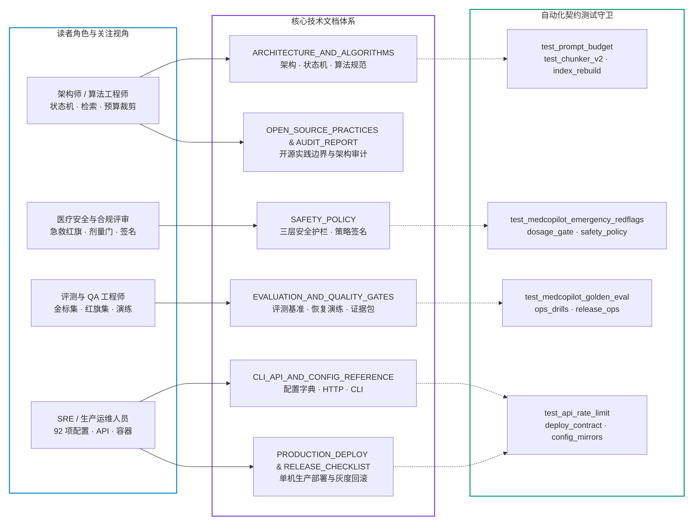

# MedCopilot（妙手回春）文档体系总览与双向导航索引

本目录是 **MedCopilot（妙手回春）**（Python 包 `medcopilot`）的
完整架构规范、医疗安全策略、评测基准、API/CLI/配置参考与生产运维文档。
所有文档均基于 `medcopilot/` 的真实源码编写，所有数学公式、默认参数、
HTTP 状态码、CLI 退出码与安全不变量均与代码逐一对齐并由回归测试套件锁定。

---

## 一、文档导航与阅读路径图

**图 1　读者角色→核心文档→自动化契约测试阅读路径**

---

## 二、文档矩阵（按主题与读者角色划分）

**表 1　核心文档矩阵（按主题与读者角色划分）**

| 文档 | 核心内容与覆盖范围 | 适用读者 | 对应核心源码模块 |
| :--- | :--- | :--- | :--- |
| **[ARCHITECTURE_AND_ALGORITHMS.md](ARCHITECTURE_AND_ALGORITHMS.md)** | **系统架构、状态机与核心算法规范**： 1. 全链路请求生命周期与自包含状态机 `AgentGraph`（`triage → pharmacist → reviewer`）； 2. 确定性字符级 Token 估算器与 `L0→L5` 医疗优先级裁剪阶梯（保护安全章节与剂量跨度）； 3. `IngestValidator` 四层摄取预校验与 `ClinicalChunker` 章节感知切分； 4. `HybridRetriever`（BM25 归一化 + Dense + RRF 融合）、`ContraindicationTrigger` 安全保护槽与 `SufficiencyGate` 锚点覆盖率； 5. `IndexManager` 蓝绿索引原子切换、`fsutil` 五步持久原子写与四大模型本地/云端适配架构 | 算法工程师、系统架构师、后端开发者 | `workflow/*` `rag/*` `safety/section_policy.py` `llm/unified_llm.py` `agents/*` `common/fsutil.py` |
| **[SAFETY_POLICY.md](SAFETY_POLICY.md)** | **医疗安全策略、急救红旗、剂量门与专家复核规范**： 1. 第一层：`EmergencyDetector` 输入源锚定守卫、抗绕过归一化、28 条（27 专科 + 1 病程演进）红旗规则及三条件保守叙事降级； 2. 第二层：`MedicalSafetyGuard` 句子词元覆盖率 + 整句相等核验，以及 `DosageGate`（`redact` 默认剥离转介 / `quote` 安全章节在场逐字引用）； 3. 第三层：`safety_policy_v1.json` 审计镜像、`canonical_sha256` 指纹、HMAC-SHA256 维护者签名、临床签核门与 `policy_check.py` 退出码 `0~4` | 医疗安全评审员、临床复核专家、合规工程师 | `workflow/emergency_detector.py` `workflow/safety_guard.py` `safety/policy.py` `scripts/policy_check.py` `scripts/policy_sign.py` |
| **[EVALUATION_AND_QUALITY_GATES.md](EVALUATION_AND_QUALITY_GATES.md)** | **评测基准、故障恢复演练与发布门禁规范**： 1. 版本化金标集 `rag_golden_v1.jsonl`（14 样本三类用例契约门与失败闭环）； 2. 急救红旗微案例集 `emergency_vignettes_v1.jsonl` 三指标硬门禁； 3. 保守抽取式评测代理 `eval_rag.py`（默认 Mock 下诚实 `expected_fail`）与可选 Ragas/DeepEval 适配器； 4. 稠密向量检索评测 `eval_embedding.py`（L1/L2 分层 Recall@1/3/5 与 MRR@5）； 5. 8 场景自动化故障恢复演练 `recovery_drill.py`、发布证据包 `release_pack.py` 与静态脱敏扫描 `redact_scan.py` | QA 工程师、评测研究者、CI/发布维护者 | `evaluation/*` `scripts/eval_*.py` `scripts/emergency_eval.py` `scripts/recovery_drill.py` `scripts/release_pack.py` `scripts/redact_scan.py` |
| **[CLI_API_AND_CONFIG_REFERENCE.md](CLI_API_AND_CONFIG_REFERENCE.md)** | **HTTP API、CLI 脚本与 92 项配置全量参考手册**： 1. `AppConfig` 配置源优先级、容器 92 键白名单与全量 92 项环境变量分类字典； 2. FastAPI 8 个 HTTP 端点（`/health/live`、`/health`、`/metrics`、`/consultations`、`/consultations/with-image`、`/documents/drug-label`、`/index/rebuild`、`/index/status`）完整契约； 3. `scripts/` 下全部 17 个 CLI 脚本的参数表与退出码规范 | API 集成方、SRE、日常开发与实验人员 | `common/config.py` `configs/medcopilot.yaml` `api/*` `deploy/entrypoint.py` `scripts/*.py` |
| **[PRODUCTION_DEPLOY.md](PRODUCTION_DEPLOY.md)** | **单机生产部署与运维手册**： 前置时钟同步检查、最小权限非 root 用户与目录布局、systemd 服务与每日备份定时器、Docker `ENTRYPOINT` secret 解析链路、Prometheus 告警规则、RPO/RTO 备份恢复演练与 7 项发布阻断门 | 运维工程师、SRE、安全审计员 | `deploy/med-rag.service` `deploy/med-rag-backup.*` `deploy/docker-entrypoint.sh` `deploy/entrypoint.py` `Dockerfile` |
| **[RELEASE_CHECKLIST.md](RELEASE_CHECKLIST.md)** | **发布清单：灰度、恢复与回滚**： 一键发布前证据包生成流程、`uv.lock` 与 `requirements*.lock.txt` 供应链哈希锁校验、单 Worker 部署约束、蓝绿索引灰度切换、故障恢复对照表与代码/索引/语料/策略四维回滚 | 发布经理、值班工程师 | `scripts/release_pack.py` `scripts/export_lock.py` `scripts/backup_snapshot.py` `rag/index_manager.py` |
| **[OPEN_SOURCE_PRACTICES.md](OPEN_SOURCE_PRACTICES.md)** | **开源与企业实践对照说明**： MedRAG、Self-BioRAG、RAGFlow、Haystack、FlashRAG、QAnything、MinerU、NeMo Guardrails、FiftyOne、Pi/pi-mono 及 Microsoft Azure RAG 实践在本项目中的设计模式映射与许可证隔离边界 | 开源贡献者、技术选型评审 | 全仓架构设计 |
| **[REFACTORING_AND_AUDIT_REPORT.md](REFACTORING_AND_AUDIT_REPORT.md)** | **系统重构与安全审计报告**： 原始 Notebook 缺陷复盘、自包含模块化重构体系、核心算法与安全并发加固纪要及已知工程/临床边界 | 项目维护者、代码审计员 | 全仓源码与测试套件 |

---

## 三、源码模块 ↔ 文档章节 ↔ 测试套件双向索引

**表 2　源码模块 ↔ 文档章节 ↔ 测试套件双向索引**

| 源码路径 | 关键类 / 函数 | 对应文档章节 | 锁定该契约的测试文件 |
| :--- | :--- | :--- | :--- |
| `common/config.py` | `AppConfig`, `_normalize_log_level`, `config` | [CLI_API_AND_CONFIG_REFERENCE.md §1](CLI_API_AND_CONFIG_REFERENCE.md#1-配置体系边界与全量-92-项-appconfig-参数字典) | `tests/test_runtime_hardening_config.py` `tests/test_config_mirrors.py` `tests/test_medcopilot_common_fsutil.py` |
| `common/logger.py` | `redact_log`, `_serialize_record`, `logger` | [CLI_API_AND_CONFIG_REFERENCE.md §1.2](CLI_API_AND_CONFIG_REFERENCE.md#12-全局日志与医疗审计配置10-项) | `tests/test_logging_release_contract.py` `tests/test_review_final_safety.py` `tests/test_review_wave6.py` |
| `common/fsutil.py` | `durable_replace`, `durable_replace_bytes`, `atomic_write_json`, `git_metadata` | [ARCHITECTURE_AND_ALGORITHMS.md §4.1](ARCHITECTURE_AND_ALGORITHMS.md#41-崩溃安全原子写原语时序图commonfsutilpy) | `tests/test_medcopilot_common_fsutil.py` |
| `agents/triage.py` | `TriageAgent`, `check_emergency`, `is_medical_query`, `route` | [ARCHITECTURE_AND_ALGORITHMS.md §1.1](ARCHITECTURE_AND_ALGORITHMS.md#11-状态对象-consultationstate-与执行节点转换图) | `tests/test_medcopilot_agents.py` `tests/test_config_mirrors.py` |
| `agents/ocr_tool.py` & `agents/ocr_api.py` | `OCRTool`, `ApiOCRTool`, `match_drug_name`, `build_ocr_tool` | [ARCHITECTURE_AND_ALGORITHMS.md §5](ARCHITECTURE_AND_ALGORITHMS.md#5-四大模型能力默认离线本地--显式云端出网门禁架构) | `tests/test_cloud_providers.py` `tests/test_review_wave4.py` `tests/test_review_wave9.py` |
| `rag/ingest_validator.py` | `IngestValidator`, `IngestValidation`, `validate` | [ARCHITECTURE_AND_ALGORITHMS.md §2.2](ARCHITECTURE_AND_ALGORITHMS.md#22-摄取端四层确定性预校验闸门ingestvalidatorvalidate) | `tests/test_ingest_validation.py` |
| `rag/clinical_chunker.py` | `ClinicalChunker`, `Document`, `chunk_drug_label`, `_split_long` | [ARCHITECTURE_AND_ALGORITHMS.md §2.3](ARCHITECTURE_AND_ALGORITHMS.md#23-临床章节感知切分器clinicalchunkerchunk_drug_label) | `tests/test_chunker_v2.py` `tests/test_review_wave3.py` `tests/test_review_wave4.py` |
| `rag/hybrid_retriever.py` | `HybridRetriever`, `bm25_search_with_scores`, `rrf_fuse_with_scores` | [ARCHITECTURE_AND_ALGORITHMS.md §3.1](ARCHITECTURE_AND_ALGORITHMS.md#31-混合检索安全保护槽与充分性门交互时序图) | `tests/test_review_final_retrieval.py` `tests/test_review_wave10_rag.py` |
| `rag/reranker.py` & `rag/reranker_api.py` | `Reranker`, `ApiReranker`, `rerank_with_status`, `weights_status` | [ARCHITECTURE_AND_ALGORITHMS.md §5](ARCHITECTURE_AND_ALGORITHMS.md#5-四大模型能力默认离线本地--显式云端出网门禁架构) | `tests/test_w5_reranker_weights.py` `tests/test_cloud_providers.py` |
| `rag/vector_store.py` & `rag/embedding_api.py` | `ChromaDenseEncoder`, `MedBgeM3EmbeddingFunction`, `ApiEmbeddingFunction` | [ARCHITECTURE_AND_ALGORITHMS.md §5](ARCHITECTURE_AND_ALGORITHMS.md#5-四大模型能力默认离线本地--显式云端出网门禁架构) | `tests/test_w4_embedding_function.py` `tests/test_embedding_api.py` `tests/test_embedding_identity.py` |
| `rag/corpus_store.py` | `CorpusStore`, `load`, `upsert_drug` | [ARCHITECTURE_AND_ALGORITHMS.md §4.2](ARCHITECTURE_AND_ALGORITHMS.md#42-蓝绿索引重建与构造性回滚状态图ragindex_managerpy) | `tests/test_medcopilot_corpus_store.py` |
| `rag/index_manager.py` | `IndexManager`, `rebuild`, `bind_active`, `corpus_hash` | [ARCHITECTURE_AND_ALGORITHMS.md §4.2](ARCHITECTURE_AND_ALGORITHMS.md#42-蓝绿索引重建与构造性回滚状态图ragindex_managerpy) | `tests/test_medcopilot_index_rebuild.py` `tests/test_w4_index_identity.py` |
| `safety/section_policy.py` | `ContraindicationTrigger`, `SufficiencyGate`, `SafetyContext` | [ARCHITECTURE_AND_ALGORITHMS.md §3.2–§3.3](ARCHITECTURE_AND_ALGORITHMS.md#32-中英混合分词与倒数排名融合rrf) | `tests/test_section_recall.py` `tests/test_sufficiency_gate.py` |
| `safety/policy.py` | `load_policy`, `check_code_equivalence`, `verify_policy_signature`, `describe_health` | [SAFETY_POLICY.md §4](SAFETY_POLICY.md#4-第三层策略工件内容指纹签名与专家复核流程safetypolicypy) | `tests/test_medcopilot_safety_policy.py` `tests/test_medcopilot_policy_signature.py` `tests/test_policy_version_surface.py` |
| `workflow/emergency_detector.py` | `EmergencyDetector`, `RedFlagRule`, `EmergencyVerdict`, `normalize_text` | [SAFETY_POLICY.md §2](SAFETY_POLICY.md#2-第一层确定性急救红旗与病程演进门workflowemergency_detectorpy) | `tests/test_medcopilot_emergency_redflags.py` |
| `workflow/safety_guard.py` | `MedicalSafetyGuard`, `DosageGate`, `check_groundedness`, `check_extractive_support` | [SAFETY_POLICY.md §3](SAFETY_POLICY.md#3-第二层抽取式忠实度核验与双模式剂量门workflowsafety_guardpy) | `tests/test_medcopilot_dosage_gate.py` `tests/test_review_wave10_safety.py` |
| `workflow/prompt_budget.py` | `PromptBudget`, `PromptBudgetFitter`, `estimate_tokens`, `clip_head` | [ARCHITECTURE_AND_ALGORITHMS.md §1.2](ARCHITECTURE_AND_ALGORITHMS.md#12-确定性-token-估算器与-l0l5-医疗优先级裁剪阶梯workflowprompt_budgetpy) | `tests/test_prompt_budget.py` `tests/test_review_wave10_context.py` |
| `workflow/agent_graph.py` | `AgentGraph`, `ConsultationState`, `ConsultationResult`, `Session` | [ARCHITECTURE_AND_ALGORITHMS.md §1.1](ARCHITECTURE_AND_ALGORITHMS.md#11-状态对象-consultationstate-与执行节点转换图) | `tests/test_medcopilot.py` `tests/test_upgrade_wave2.py` |
| `llm/unified_llm.py` | `UnifiedLLM`, `LLMInvocation`, `invoke_with_status`, `classify_mode` | [ARCHITECTURE_AND_ALGORITHMS.md §5](ARCHITECTURE_AND_ALGORITHMS.md#5-四大模型能力默认离线本地--显式云端出网门禁架构) | `tests/test_unified_llm_hardening.py` `tests/test_llm_messages.py` |
| `audit/audit_log.py` & `audit/evidence_event.py` | `AuditLogger`, `AuditEvent`, `EvidenceEvent`, `verify_chain` | [CLI_API_AND_CONFIG_REFERENCE.md §1.2](CLI_API_AND_CONFIG_REFERENCE.md#12-全局日志与医疗审计配置10-项) | `tests/test_audit_log.py` `tests/test_evidence_event.py` |
| `api/server.py`, `api/rate_limit.py`, `api/session_store.py`, `api/env_policy.py` | `create_app`, `BodySizeLimitMiddleware`, `SlidingWindowLimiter`, `SessionStore`, `classify_env` | [CLI_API_AND_CONFIG_REFERENCE.md §2](CLI_API_AND_CONFIG_REFERENCE.md#2-fastapi-http-端点与-prometheus-指标契约apiserverpy) | `tests/test_api_rate_limit.py` `tests/test_env_default_deny.py` `tests/test_review_wave8.py` `tests/test_review_wave10_api.py` |
| `ui/app.py` & `ui/api_client.py` | `MedApiClient`, `build_demo`, `DISCLAIMER_BANNER_MARKDOWN` | [CLI_API_AND_CONFIG_REFERENCE.md §1.4](CLI_API_AND_CONFIG_REFERENCE.md#14-api-鉴权cors限流并发闸会话与语料存储配置16-项) | `tests/test_medcopilot_ui_api_client.py` `tests/test_ui_disclaimer_banner.py` |
| `deploy/entrypoint.py` | `ALLOWLIST_ENV_KEYS`, `load_secret_env`, `main` | [PRODUCTION_DEPLOY.md §8](PRODUCTION_DEPLOY.md#8-docker-路径) | `tests/test_deploy_contract.py` |
| `evaluation/*` & `scripts/*` | `load_golden_dataset`, `run_golden`, `release_pack`, `recovery_drill`, `backup_snapshot`, `export_lock`, `redact_scan` | [EVALUATION_AND_QUALITY_GATES.md §1–§6](EVALUATION_AND_QUALITY_GATES.md#1-版本化-rag-金标集确定性行为门evaluationgolden_evalpy--scriptseval_goldenpy) | `tests/test_medcopilot_golden_eval.py` `tests/test_ops_drills.py` `tests/test_release_ops.py` `tests/test_backup_snapshot.py` `tests/test_supply_chain_lock.py` |

---

## 四、社区治理与工程规范文件

- **项目主文档**：[../../README.md](../../README.md)
- **开源许可证**：[../../LICENSE](../../LICENSE)（MIT License）
