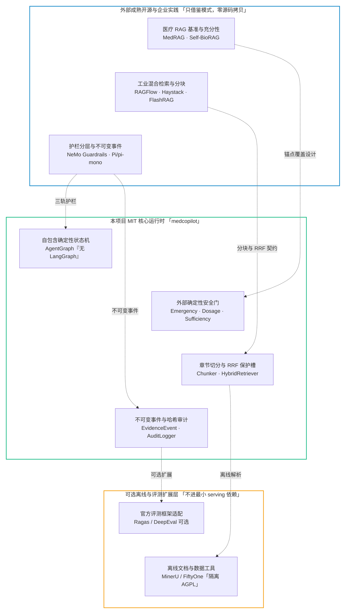

## 0. 对照项目清单与复用决策

下表是本项目当前采用的“参考/复用/拒绝”决策。
许可证与仓库身份以 GitHub 仓库页面为准，开源版本不会复制第三方源码到核心路径。

### 开源模式复用与许可证隔离架构图



**图 1　外部开源模式借鉴、MIT 核心运行时与可选扩展层隔离**

**表 1　对照项目清单与复用决策**

| 项目 | 可信用途 | 当前决策 |
|---|---|---|
| [MedRAG](https://github.com/Teddy-XiongGZ/MedRAG) / MIRAGE | 医疗语料、检索器、LLM 可插拔；适合作为医疗 RAG 回归基准参考 | **借鉴评测分层**，不复制其数据或运行时依赖 |
| [Self-BioRAG](https://github.com/dmis-lab/self-biorag) | 自我反思检索、证据充分性和答案支撑判断 | **只借鉴实验设计**；医疗硬门仍用本项目确定性 gate，不让 LLM 自我反思替代安全门 |
| [Medical-Graph-RAG](https://github.com/ImprintLab/Medical-Graph-RAG) | 药品/适应症/禁忌/相互作用的图结构组织 | **作为后续可选知识图谱层**；当前 corpus 规模不需要引入 Neo4j |
| [RAGFlow](https://github.com/infiniflow/ragflow) | 复杂 PDF、表格、OCR、混合检索、重排 | **借鉴 chunk/表格/重排思路**；不引入其大型服务栈，保持轻量 self-contained |
| [Haystack](https://github.com/deepset-ai/haystack) | 类型化 pipeline、BM25+dense+RRF、ranker、MRR/Recall evaluator | **借鉴接口与评测契约**；不引入框架，遵守本项目无 LangChain/LangGraph 约束 |
| [FlashRAG](https://github.com/RUC-NLPIR/FlashRAG) | 研究型 retriever/reranker/evaluator 拆分 | **借鉴实验矩阵和可复现评测** |
| [QAnything](https://github.com/netease-youdao/QAnything) | 中文文档 QA、离线部署和中文工程经验 | **借鉴开源发布/中文运行边界**；不复制 AGPL 代码进入 MIT 核心 |
| [MinerU](https://github.com/opendatalab/MinerU) | 中文 PDF 版式、表格、公式、OCR 转 Markdown/JSON | **作为可选离线 ingestion 前端**；不得成为 serving 硬依赖 |
| [NeMo Guardrails](https://github.com/NVIDIA-NeMo/Guardrails) | input/dialog/retrieval/output/tool rails | **借鉴 rail 分层**；当前确定性安全门保留在 Python 外部代码，避免新增模型/DSL 依赖 |
| [Guardrails AI](https://github.com/guardrails-ai/guardrails) | Pydantic/结构化输出与 schema validation | **可选 adapter**；不替代 DosageGate 和 extractive gate |
| [FiftyOne](https://github.com/voxel51/fiftyone) | OCR 图片数据集浏览、人工复核、错误样本管理 | **可选 eval/dev 工具**；不进 FastAPI 核心运行时 |
| [Pi/pi-mono](https://github.com/badlogic/pi-mono) | provider 抽象、扩展、不可变事件、session compaction、事件生命周期 | **借鉴模式**；不引入 coding-agent runtime |

### 许可证和依赖边界

- `RAGFlow`、`Haystack`、`FlashRAG`、
`Medical-Graph-RAG` 等许可证/依赖边界必须在真正引入源码时重新核对；
当前仅引用架构和公开文档，不复制源码。
- `QAnything` 的 AGPL-3.0 许可证不进入本项目 MIT 核心依赖，避免许可证传染。
- `MinerU`、FiftyOne、NeMo Guardrails、
RAGAS/DeepEval 都作为可选研究/评测/离线 ingestion 工具，不进入最小开源安装。
- 核心 serving 路径只依赖当前 `pyproject.toml` 声明的最小组件和确定性安全代码。


**目标**：说明当前项目从哪些成熟开源/企业实践中借鉴了哪些工程模式，
以及哪些部分明确不引入，避免“为了复用框架而复用框架”。

## 1. Pi / pi-mono：复用模式，不引入运行时

Pi 是高质量的可扩展 coding-agent harness。当前项目不直接引入 Pi，因为：

- 当前仓库必须保持 Python、自包含状态机、无 LangChain/LangGraph；
- 医疗安全门必须在 LLM 外部由确定性代码执行；
- Pi 的 coding-agent tool loop 与医疗说明书问答的安全边界不同。

可复用的设计模式已经落在当前项目：

**表 2　Pi/pi-mono 设计模式复用映射**

| Pi 风格能力 | 当前项目对应物 | 复用方式 |
|---|---|---|
| 统一多 provider API | `llm/unified_llm.py` | `LLMInvocation` 作为不可变请求结果；provider-specific 错误不泄漏 |
| 事件/结果驱动状态 | `ConsultationResult`、`EvidenceEvent` | 状态随返回值传播，不依赖共享 `_last_invocation_error` |
| Extension hooks | `rag_official_adapter.py`、`policy_sign.py`、`backup_snapshot.py` | 可选能力只在脚本/adapter 层，不污染核心 serving path |
| Session/compaction | `Session` + bounded TTL | 历史轮次物理有界，未来可加入 token-budget compaction |
| Structured tool/event contract | `AuditEvent`、`EvidenceEvent`、`LLMInvocation` | 事件不可变、可哈希、可回放 |
| Provider matrix | `scripts/llm_matrix_probe.py` | 真实 provider 诊断与 Mock 行为分离 |

**不复用**：Pi 的 coding tools、文件修改能力、agent loop、
prompt 级安全控制不会进入医疗 serving path。

参考：[Pi Context7 library](https://context7.com/earendil-works/pi)、
[Pi 官方站点](https://pi.dev/)。

## 2. Microsoft RAG Experiment Accelerator / Azure AI Search

Microsoft 官方 RAG 文档反复强调：

- retrieval evaluation 和 response evaluation 分层；
- document retrieval 使用 qrels、NDCG、fidelity、holes 等指标；
- groundedness 关注 precision，completeness 关注 recall；
- 生产需要 evaluation、monitoring、tracing 三层；
- hybrid search 结合关键词和向量检索；
- chunking 应尊重标题、段落、句子和表格边界。

当前项目已复用：

- `eval_golden.py`：确定性 routing/retrieval/abstention gate；
- `rag_official_adapter.py`：可选 DeepEval/RAGAS adapter，
不改变 serving 逻辑；
- `EvidenceEvent`：为未来 OpenTelemetry/WORM/评测链提供结构化事件；
- chunker v2：章节边界、换行/句末优先、剂量保护、overlap；
- BM25+dense hybrid 架构及 BM25 fallback。

明确不做：不把 LLM judge 作为医疗安全硬门；确定性 grounding、剂量、急救、
禁忌门仍由代码执行。

参考：
[Microsoft RAG evaluators](https://learn.microsoft.com/azure/foundry/concepts/evaluation-evaluators/rag-evaluators)、
[RAG Experiment Accelerator](https://github.com/microsoft/rag-experiment-accelerator)、
[Azure classic RAG sample](https://github.com/Azure-Samples/azure-search-classic-rag)。

## 3. OpenTelemetry / GenAIOps

企业级实践将 LLM 应用拆成：

```text
evaluation → monitoring → tracing
```

当前项目已具备：

- PHI-free `AuditLogger` + SHA-256 hash chain；
- `EvidenceEvent`：policy/corpus/model/evidence/input/output hash；
- request/session/policy/evidence 可追溯字段；
- release evidence artifact；
- emergency、degradation、OCR、policy、index 状态。

后续可选增强：

```bash
pip install opentelemetry-api opentelemetry-sdk
```

但必须遵守：生产默认不记录 query/answer/OCR 原文；只记录 hash、ID、
指标和决策状态。Microsoft 官方明确提醒，
生产 tracing 不应默认打开敏感 prompt/response 数据。

参考：
[OpenTelemetry Python](https://context7.com/open-telemetry/opentelemetry-python)、
[Microsoft GenAI observability](https://learn.microsoft.com/azure/foundry/concepts/observability)。

## 4. FiftyOne：可选数据审查层，不进入核心运行时

FiftyOne 适合：

- OCR 药盒图片数据集浏览；
- 按 OCR 状态筛选样本；
- 查看人工标注与模型预测差异；
- 形成 clinical review / data curation 工作台；
- 导出审查后的样本集。

不适合直接放进：

- FastAPI request path；
- 急救判定；
- DosageGate；
- 核心 RAG serving；
- 生产必装依赖。

建议未来以可选工具实现：

```python
# 可选开发/评测环境，不在 production dependencies
import fiftyone as fo

# 将脱敏后的 OCR 评测图片、ocr_status、matched_drug、review_label
# 导入独立数据集，用于人工复核和错误分析。
```

当前仓库的 OCR 结果已经可以通过 `AuditEvent` 和测试 fixture 导出，
因此接入 FiftyOne 只应是评测层 adapter，不应成为安全门依赖。

参考：
[FiftyOne SDK guidance](https://docs.voxel51.com/user_guide/basics.html)。

## 5. Guardrails 项目复用边界

可借鉴的成熟 guardrail 项目通常提供：

- 输入 prompt-injection 检测；
- PII masking；
- 输出 policy validation；
- tracing 和评测集成。

当前项目不直接依赖这些项目作为医疗硬门，因为：

1. 第三方 guardrail 模型本身也可能被注入；
2. 额外模型会增加供应链和离线部署复杂度；
3. 医疗关键规则必须由本地确定性代码执行；
4. 现有 `_wrap_untrusted` 明确只是提示澄清层，不是假装成安全边界。

适合的复用方式是：

```text
确定性安全门（必须）
  + 可选 guardrail 模型（辅助告警/评测）
  + human review（高风险发布/策略签核）
```

## 6. 复用结论

**表 3　可选能力引入边界判定**

| 能力 | 是否直接引入 | 当前处理 |
|---|---:|---|
| Pi runtime | 否 | 复用 immutable events、provider adapter、extensions、session patterns |
| RAGAS/DeepEval | 否（核心运行时） | 可选 offline adapter |
| OpenTelemetry | 否（默认依赖） | 已有 EvidenceEvent/AuditLogger，未来可选 exporter |
| FiftyOne | 否（核心运行时） | 可选 OCR/图片数据审查工具 |
| Guardrail LLM | 否（硬门） | 可选辅助检测，不替代确定性门 |
| Microsoft RAG patterns | 是，按模式复用 | chunking、hybrid search、qrels、groundedness/completeness 分层 |

**原则**：复用成熟项目中已经验证的设计思想和接口契约；不把不匹配的运行时框架、
额外模型或大依赖强行塞入医疗安全核心路径。
