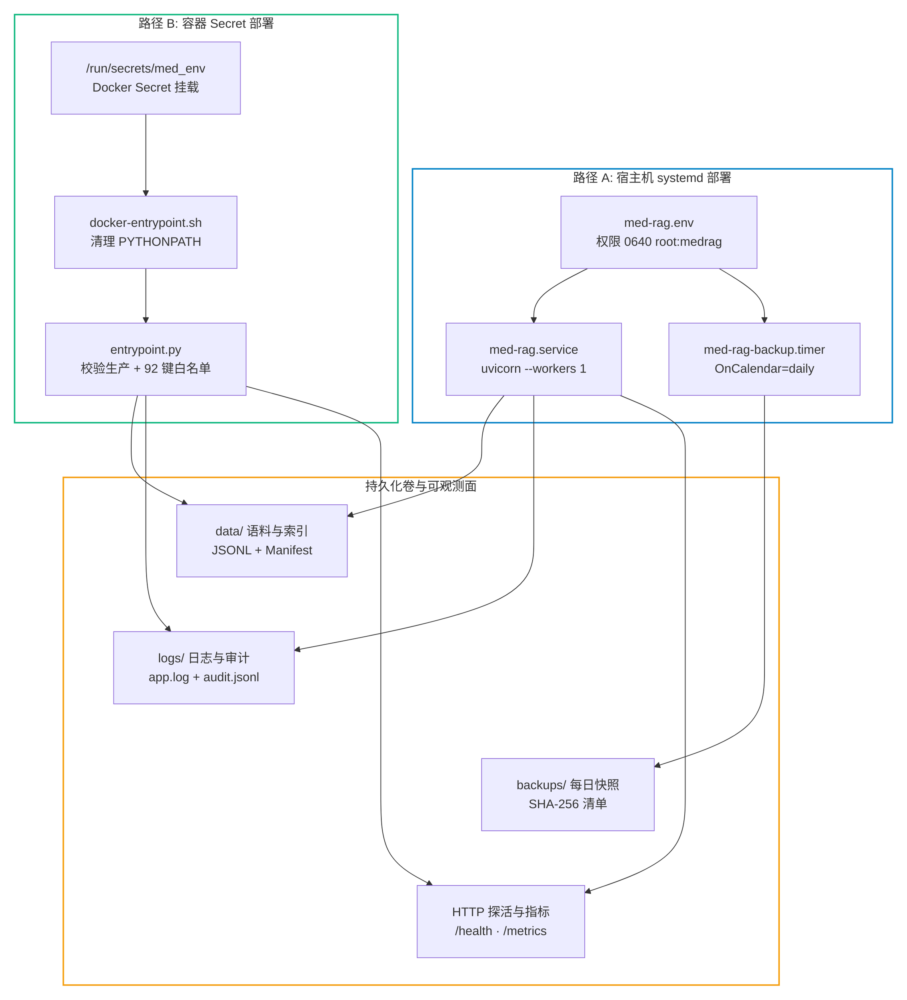

# 单机生产部署手册（W5.5 / W5.7）

> 本手册只描述**工程部署**。它不构成临床验收：医疗安全适当性由
> `datasets/policies/safety_policy_v1.json` 的评审记录与真实专家复核负责
> （见 `SAFETY_POLICY.md`）。**本手册完成不代表系统达到"临床可用"状态**——
> 见 §10 的发布阻断门。
>
> 配套工件（与手册保持同步， tests/test_deploy_contract.py 钉死契约）：
>
> | 文件 | 用途 |
> | --- | --- |
> | `medcopilot/deploy/med-rag.service` | API 服务单元（非 root、单 worker） |
> | `medcopilot/deploy/med-rag-backup.service` / `.timer` | 每日语料快照（RPO 目标 24h） |
> | `medcopilot/deploy/docker-entrypoint.sh` | 容器入口（只 exec，不 source 任何 env 文件） |
> | `medcopilot/deploy/entrypoint.py` | secret 解析与 allowlist 导出，随后 exec uvicorn |

单元文件中的路径（`/etc/med-rag`、`/var/lib/med-rag`、`/opt/med-rag`、
`/usr/bin/python3`）是
约定值而非机器本地路径：按需整体改动机读，**任何密钥/令牌一律只进
`/etc/med-rag/med-rag.env`，不写入本仓库**。

### 单机生产部署双通道（systemd vs Docker）架构图



**图 1　systemd 与 Docker Secret 双通道生产部署架构**

## 0. 前置检查（发布阻断门对应项）

- [ ] **时钟同步**：`timedatectl status | grep -i synchronized` 必须为 `yes`；
      未同步先 `sudo timedatectl set-ntp true`。审计保留期起算依赖同步时钟
      （HIPAA 审计时间语义），所以 API 单元带 `After=time-sync.target`。
- [ ] **时区**：宿主与容器约定同一时区（容器 `ENV TZ=UTC`，由 Dockerfile 负责）。
      备份 timer 的 `OnCalendar=daily` 是**宿主机本地时间**的 00:00；
若宿主时区被
      改动，等价于改动备份触发点——改动时区视同变更备份窗口，
需重新走本手册 §5。
- [ ] **镜像来源**：
镜像 digest 来自 CI supply-chain + image job 全绿产物（含 SBOM）；
      禁止用本地未评审构建直接跑生产。
- [ ] **env 文件双签**：
`/etc/med-rag/med-rag.env` 由运维与安全双方审签（密钥不入 Git）。
- [ ] **策略签名与临床签核**（G3 阻断项）：
`policy_check` 通过且维护者 signature 在案；
      `clinical_signoff` 在无资质签核时按设计 FAIL——无真实专家签核不得发布（§10）。

## 1. 安装（最小路径）

```bash
# 运行用户（非 root）：最小权限，无登录 shell
sudo useradd --system --home-dir /var/lib/med-rag --shell /usr/sbin/nologin medrag

# 目录：配置 750/640，数据/日志/备份归运行用户所有
sudo install -d -m 750 -o medrag -g medrag /etc/med-rag /var/lib/med-rag/data /var/lib/med-rag/logs /var/lib/med-rag/backups
sudo cp /path/to/reviewed/med-rag.env /etc/med-rag/med-rag.env
sudo chown root:medrag /etc/med-rag/med-rag.env && sudo chmod 640 /etc/med-rag/med-rag.env

# 代码部署到 /opt/med-rag（git 检出或 CI 产物解包），保持只读给运行用户
sudo install -d -o root -g root -m 755 /opt/med-rag

# 快照单元用的布局键（systemd 专用，不进容器 allowlist）
# 权重/检索缓存必须指向 $HOME 之外（单元带 ProtectHome=yes）
```

`/etc/med-rag/med-rag.env` 模板（键名与仓库根 `.env.example` 一致；
`#` 注释保留）：

```ini
# --- 必填（W1.3 默认拒绝：空值/错拼读写 503）---
PROJECT_ENV=production
ADMIN_API_KEY=<openssl rand -hex 32 的结果，勿写入本仓库>
# --- 审计 sink（生产必须；保留 6 年）---
AUDIT_LOG_PATH=/var/lib/med-rag/logs/audit.jsonl
AUDIT_RETENTION_DAYS=2190
# --- 权威语料（幂等摄取 + 重启恢复 + 快照源目录的父级）---
MED_CORPUS_PATH=/var/lib/med-rag/data/documents.jsonl
LOG_FORMAT=json
LOG_FILE=/var/lib/med-rag/logs/app.log
# --- 主机头白名单：固定对外主机名，禁用 '*' ---
MED_TRUSTED_HOSTS=med.example.com
# --- 离线权重：运行期不下载；缓存放 /home 之外 ---
HF_HUB_OFFLINE=1
MODEL_WEIGHTS_OFFLINE=true
RERANKER_MODEL=BAAI/bge-reranker-base
EMBEDDING_CACHE_DIR=/opt/med-rag/hf-cache
RERANK_CACHE_DIR=/opt/med-rag/hf-cache
# --- 剂量门（W6.1）：默认 redact；quote 需产品定位接受逐字说明书展示 ---
DOSAGE_GATE_MODE=redact
# --- 稠密检索：默认关闭（BM25+TF-IDF 代理）；opt-in，转 true 前需真实指标 ---
ENABLE_CHROMA_DENSE=false
# --- systemd 备份单元专用（非 AppConfig 别名，容器入口 allowlist 会丢弃）---
MED_CORPUS_DIR=/var/lib/med-rag/data
MED_BACKUP_DIR=/var/lib/med-rag/backups
```

注意：

- `configs/` 下的 YAML/txt 是**只读参考镜像**，运行期从不加载；改行为只能改
  env/代码常量（`tests/config_mirrors` 有契约测试）。
- AppConfig 还会读取工作目录下的 `.env`（pydantic-settings 语义）。
**不要**把一个
  `.env` 丢进 `/opt/med-rag`：环境变量优先级高于 `.env`，同名键会以 env 为准，
  但遗留 `.env` 仍会造成"改了不生效"的排查歧义。
- 密钥只允许出现在 `/etc/med-rag/med-rag.env`（systemd 路径）
或 docker secret
  （容器路径）。禁止提交进 Git、禁止写进 journal 说明、禁止进镜像层。

## 2. systemd 单元

```bash
sudo cp medcopilot/deploy/med-rag.service /etc/systemd/system/
sudo cp medcopilot/deploy/med-rag-backup.service /etc/systemd/system/
sudo cp medcopilot/deploy/med-rag-backup.timer /etc/systemd/system/
sudo systemctl daemon-reload
sudo systemctl enable --now med-rag med-rag-backup.timer
```

单元要点（为什么这样写）：

- **单 worker**：`--workers 1` 是硬不变式——会话存储与权威语料均为进程本地
  （RELEASE_CHECKLIST §2）。任何"扩容"想法先读 §10 边界。
- **非 root**：`User=medrag` + `NoNewPrivileges=yes` + `ProtectSystem=strict`
  （整盘只读，`ReadWritePaths=/var/lib/med-rag` 之外不可写）
+ `ProtectHome=yes`
  + `PrivateTmp=yes`。刻意保持小而安全（不启用 `MemoryDenyWriteExecute` 等会
  与 JIT/OpenMP 冲突的选项）。
- **fail-closed**：`EnvironmentFile` 无 `-` 前缀——env 文件缺失 → 单元启动失败，
  而不是带着默认配置裸奔。
- **时钟**：`After=time-sync.target`；NTP 是审计前置（§0）。
- **备份单元**：`ExecStartPre=/usr/bin/test -n "${MED_*_DIR}"` 防止空变量展开成
  空路径参数；快照 CLI 见 `scripts/backup_snapshot.py`。

## 3. 验收（5 分钟）

```bash
# 存活面：零依赖，只证明进程活着（容器探针/负载检查用它）
curl -fsS http://127.0.0.1:8000/health/live
# 就绪面：详情需 Bearer；匿名只拿到精简面（OWASP API8 不泄漏运维清单）
curl -fsS -H "Authorization: Bearer $ADMIN_API_KEY" http://127.0.0.1:8000/health | jq '.'
# 指标面：仅 admin
curl -fsS -H "Authorization: Bearer $ADMIN_API_KEY" http://127.0.0.1:8000/metrics | grep med_rag_
sudo journalctl -u med-rag -f          # JSON 结构化行（LOG_FORMAT=json）
tail -f /var/lib/med-rag/logs/audit.jsonl
```

期望：`/health` 的 `env_recognized=true`、`env_class=production`、
`audit_ready=true`、
`policy` 组件状态 healthy。`rerank_mode=lexical` 在 base 镜像（无权重）
下是**预期的离线
降级**，不是故障（§8）；`dense_degraded=true` 同理。

## 4. 日志采集接线（任选其一）

- journald：rsyslog 转发 / journal-remote / Promtail scrape journal。
- 文件：
`/var/lib/med-rag/logs/{app.log,audit.jsonl}`（app.log 由 AppConfig 轮转；
  audit.jsonl 由审计 sink 轮转），交给 filebeat/fluent-bit。
- 审计外送的保留期按 `AUDIT_RETENTION_DAYS`（6 年）；
外送链路自身也要时钟同步。

## 5. 备份与恢复（RPO/RTO 是目标，不是已测量结论）

```bash
sudo systemctl start med-rag-backup.service      # 手动触发一次，验证落盘
python medcopilot/scripts/backup_snapshot.py verify /var/lib/med-rag/backups/<UTC时间戳目录>
```

- **RPO ≤ 24h / RTO ≤ 30min 是部署目标（objectives）**：由每日快照达成 RPO 上限，
  由 `recovery_drill.py` 场景 7（备份→注入丢失→恢复→复跑）实测 RTO 并随
  `outputs/recovery_drill.json` 进发布证据。**未经演练的备份视为不存在**；上线前
  必须在目标机至少演练一次，并把实测值记录在案。
- 恢复 = 停服务 → 用快照副本替换 `MED_CORPUS_PATH` → `verify` 通过 → 重启 →
  `POST /index/rebuild`（索引可重建派生）。
篡改快照的恢复会被 SHA-256 校验拒绝
  （fail-closed，绝不恢复损坏数据）。
- `OnCalendar=daily` 为精确每日触发、**刻意不加 `RandomizedDelaySec`**：
备份时间戳
  需要与同步时钟对齐以支撑审计语义。
多机错峰是运维侧 discretion——写在各自 drop-in
  里，本仓库保持确定性默认值。
- 快照含公开说明书数据（非 PHI），权限 `UMask=0077`（0600）；密钥绝不进快照。
  建议备份 root 与主数据异盘（介质级故障覆盖）。

## 6. 指标与告警

`/metrics` 仅 admin（Bearer），Prometheus 文本格式。采集示例：

```yaml
scrape_configs:
  - job_name: med-rag
    bearer_token_file: /etc/prometheus/med-rag-token
    static_configs: [{targets: ["127.0.0.1:8000"]}]
```

告警起点（阈值需在目标硬件按真实负载校准，手册不预设数字结论）：

```promql
med_rag_llm_mode != 2                      # 0=error/disabled, 1=mock/lexical, 2=live：生产不得长期非 live
med_rag_degradations_total > 0             # rerank/dense 降级可见
med_rag_audit_write_failures_total > 0     # 审计 sink 故障（fail-closed 前可见）
med_rag_requests_total{status=~"5.."}      # 5xx 增长
```

## 7. 升级与回滚

- 升级：
拉新 digest → 手动触发一次备份 → `systemctl restart med-rag` → `/health`
  ready + 金标门/策略门在目标机复跑（`scripts/eval_golden.py`、
`scripts/policy_check.py`）。
- 回滚代码：上一个 digest + restart；回滚语料：
恢复快照 → 重启 → `/index/rebuild`。
- 策略工件回滚必须连带回滚代码常量（等价守护测试强制二者一致）。

## 8. Docker 路径

构建与运行（`ENTRYPOINT`/`CMD` 由根 `Dockerfile` 维护；本仓库提供入口脚本）：

```bash
docker run -d --name med-rag \
  --secret med_env \                                  # dotenv 语法，整份 env 走文件
  -v /var/lib/med-rag/data:/var/lib/med-rag/data \
  -v /var/lib/med-rag/logs:/var/lib/med-rag/logs \
  <ci-image-digest>
```

- **默认入口即包装器（C6）**：镜像 `ENTRYPOINT` 为 exec 形式的
  `["/app/medcopilot/deploy/docker-entrypoint.sh"]`，因此上面这条
  **不做任何入口覆盖**的命令也一定经过 secret 通道——不存在"文档命令绕过
  入口脚本"的路径。运营者**不要**再覆盖入口；确需覆盖时须知
  `/run/secrets/med_env` 将无人解析（服务 503），且**禁止**改用
  `-e ADMIN_API_KEY=...`（密钥会进 inspect/history）。
`CMD` 仍是那条单 worker
  uvicorn 命令（入口最终 exec 的就是它）；包装器忽略 CMD 额外参数——
  `--workers 1` 是硬不变式，不可从命令行放宽。
- **可执行位在镜像内保证**：入口脚本的 exec 位由镜像内
  `RUN chmod 0755 .../docker-entrypoint.sh` 设置（在 `USER appuser` 之前，
  以 root 执行），**不依赖**构建机的文件模式或 git index 的 mode 位——
  Windows 构建上下文与 `core.fileMode=false` 的检出都会丢 POSIX 权限位。
- **入口不 source**：`deploy/docker-entrypoint.sh` 先 `unset PYTHONPATH LD_PRELOAD`
  （解释器钩子必须在 launcher 的 python3 启动**之前**消失：
  launcher 自身的 scrub 只能保护它 exec 的进程，而 LD_PRELOAD 对已启动的解释器无效），
  再 `exec python3 -m medcopilot.deploy.entrypoint <secret 路径>`。
  secret 文件由 Python（python-dotenv，`interpolate=False`）按**数据**解析——
  永远不会把 `$(...)`/`${VAR}` 当命令执行，也不可能写入任意 shell。
- **allowlist 导出**：只导出 AppConfig 别名（92 个键，契约测试与
  `AppConfig.model_fields` 断言相等）；`PYTHONPATH`/`LD_PRELOAD` 既不允许从
  secret 进入、也会在继承到时被移除（包装器与 launcher 两层）。
- **顺序保证**：secret 解析/导出发生在 `exec uvicorn` **之前**；应用的
  AppConfig import 发生在 exec 之后 → 启动读取的总是合并后的环境。
- **PROJECT_ENV 校验**：入口要求 `PROJECT_ENV` 分类为 production，否则直接
  退出（fail-closed，诊断信息不含任何密钥值）。
- **env 回退**：secret 文件**不存在**时回退到容器环境（`--env-file` / `-e` /
  镜像 ENV），
生产面仍由 `PROJECT_ENV` 校验与 `ADMIN_API_KEY` fail-closed 兜底。
  secret 路径是**坏符号链接**（secret 挂载断裂）时入口拒绝启动并明示
  `broken symlink`——不回退、不静默使用 ambient env。
- **单 worker**：入口固定 `--workers 1`，与 systemd 路径一致，不要覆盖。
- **镜像目标（单阶段）**：根 `Dockerfile` 是**单阶段**镜像——没有单独的
  `runtime`/`offline-runtime` 多阶段目标。权重烘焙是 opt-in：
  `--build-arg BAKE_WEIGHTS=1` 在构建期预置 reranker/embedding 权重
  （需构建期联网）；默认 `0` 时 base 镜像**不含权重**，重排降级 `lexical`、
  稠密检索 `dense_degraded`，属预期离线行为，需稠密检索须以
  `BAKE_WEIGHTS=1` 构建。
- **依赖锁定**：仓库根 `uv.lock` 为唯一 lock；镜像构建用**带哈希的 pinned
  requirements 导出**（`uv export --require-hashes` 产物），安装时逐工件校验
  digest，哈希不符即构建失败（fail-closed）。CI 侧以 `uv lock --check` 保证
  lock 与 pyproject 同步。不要绕过锁定直接 `pip install`。
- **opt-in 稠密检索**：`ENABLE_CHROMA_DENSE` 默认 `false`，在拿到真实负载/质量
  指标前保持关闭；开启前先在预发实例量测，再改 env。
- **健康检查**：`/health/live` 零依赖探活（python urllib，无 curl 依赖）。
- **UI 免责横幅**：免责文案唯一事实来源是 `workflow/safety_guard.py` 的
  `DISCLAIMER_TEXT`（UI 静态横幅由 UI 切片负责，逐字节一致，勿在部署侧改写）。

## 9. 已知边界（不要越界）

- 单实例部署：会话/语料进程本地；多实例需外置状态，不在本仓库范围。
- **次数维度（每 IP/每连接请求频率）属于入口层**：
应用内 `BodySizeLimitMiddleware`
  只卡**字节**（multipart 解析前，≤11MiB/请求，超限精确一次 413），应用级限流
  （`MED_RATE_LIMIT_*`）按已鉴权身份计数、且急救红线按契约**先于鉴权与限流**
  （不可为限流而推迟 120 应答）——因此未认证调用方的**请求次数**只能由反代/网关
  （连接级并发与频率限制）承担。急救洪水的每请求副作用已在应用内收敛：不建
  会话、
审计行超预算后按窗聚合（`/health` 的 `abuse_controls.emergency_flood_suppressed`
  可见），应答恒为固定 120 文案。
- RPO/RTO 是目标值：实测值以 recovery drill 证据为准，未演练不得宣称达成。
- 压测只验证连接层健康；吞吐/容量结论须在目标硬件测量。
- 真实云厂商线上联调（LLM / Embedding / Reranker / OCR）
需在具备合规授权与真实密钥的目标环境中单独执行。
- 临床适当性**不由本手册或任何工程证据证明**（§10）。

## 10. 发布阻断门（工程侧摘要）

**表 1　发布阻断门清单**

| 门 | 判定 | 证据 |
| --- | --- | --- |
| 全量非 slow 测试 + 配置镜像一致性 | 全绿 | `release_pack.json` |
| 金标行为门 | exit 0 | `eval_golden` |
| 策略门禁（工件=代码、approved 评审） | exit 0 | `policy_check` |
| 恢复演练（含备份恢复场景） | 全 PASS | `recovery_drill.json` |
| 依赖锁定/supply-chain/镜像扫描 + SBOM | 全绿 | CI 工件 |
| 权重离线（`BAKE_WEIGHTS=1` 构建的镜像） | `reranker.weights == local` | image smoke |
| **策略签名 + 临床签核** | **在案 / signed** | `policy_sign` 记录；`clinical_signoff` 未签核 → 阻断 |

诚实项：mock 下 `rag_quality` 按设计 FAIL（`expected_fail`，不阻断）；
`clinical_signoff` 无资质签核前按设计 FAIL。**两者补齐之前，任何
"生产就绪/临床可用"的表述都是不诚实的。**
