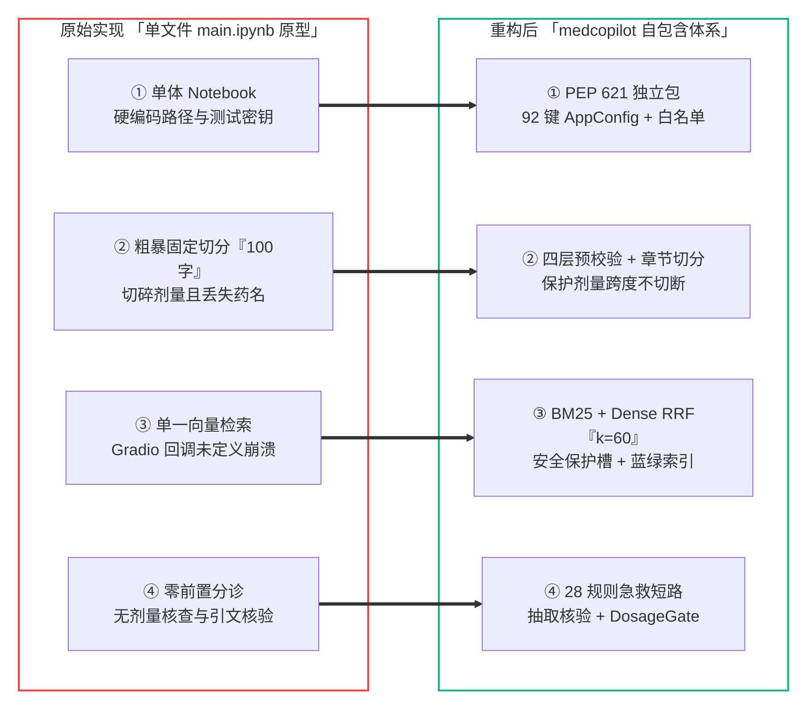

# MedCopilot（妙手回春）架构重构与安全审计报告

## 一、原始代码审计与问题复盘 (Source Code Review & Audit)

### 1. 项目定位
**MedCopilot（妙手回春）**（代码包标识 `medcopilot`）
是面向药品说明书问答与用药安全辅助的智能医疗 RAG 系统，核心链路涵盖：
药盒图片 OCR 提取 → 药品说明书临床章节切分与入库校验 → BM25 + Dense 混合检索与 RRF 融合 → CrossEncoder 重排 → 多厂商 LLM 生成 → 确定性医疗安全护栏审查 → FastAPI 服务与 Gradio 交互界面。

### 2. 原始实现核心缺陷与重构对策



**图 1　原始单体原型与重构后自包含工程体系对比**

**表 1　原始实现核心缺陷与重构对策**

| 模块 | 原始实现形态 | 潜在技术隐患 / 致命缺陷 | 重构与加固方案 |
| :--- | :--- | :--- | :--- |
| **工程结构** | 单个超大 `main.ipynb`，将 Base64 输出图片与硬编码路径混入笔记本 | 无法版本控制、无法模块化复用、缺乏独立配置与自动化测试 | 重构为标准 PEP 621 模块化包 `medcopilot`，内建独立 `common/` 基础库，完全自包含 |
| **RAG 切分与入库** | 粗暴 `CharacterTextSplitter(chunk_size=100)`，无章节感知与入库校验 | 【用法用量】、【禁忌】与药名脱钩，剂量数字被从中间切断，脏数据直接污染向量库 | 研发 `ClinicalChunker`（章节感知 + 剂量跨块保护）与 `IngestValidator`（必填章节 + 危险缩写/裸小数点预校验） |
| **检索与重排** | 单一 Dense 向量余弦检索 | 临床生僻词、特定禁忌症在向量空间被稀释，且网络或模型异常时直接崩溃 | 研发 `HybridRetriever`（BM25 + Dense + RRF 倒数排名融合）与 `Reranker`（CrossEncoder / 云端重排 + 词法降级可见性） |
| **医疗安全护栏** | 无前置分诊、无剂量核查、无后置引文对齐 | 遇到心梗/中毒等急症仍慢速调用 LLM，且可能输出篡改或虚构的用药剂量 | 构建 `EmergencyDetector`（毫秒级红旗与病程演进短路）+ `DosageGate`（默认剂量剥离/逐字安全引文门）+ `MedicalSafetyGuard` |
| **本地/云端边界** | 隐式调用外部接口、硬编码本地路径与测试 Token | 敏感医疗文本/药盒图片无意出网、生产环境缺密钥时静默降级或泄漏凭据 | 四大模型能力默认本地离线（`local`），切换 `cloud` 必须显式开启 `ALLOW_TEXT_EGRESS` / `ALLOW_IMAGE_EGRESS` 并强制 HTTPS |

---

## 二、自包含模块化架构体系

`medcopilot` 已完成与外部兄弟项目的彻底解耦，所有配置、日志、
原子写原语、业务模块、评测集与部署工件均收敛于本目录内：

```text
medcopilot/
├── common/                        # 独立基础库：AppConfig + Loguru 脱敏日志 + fsutil 持久原子写
├── agents/                        # triage 分诊路由 / ocr_tool 本地 PaddleOCR / ocr_api 云端视觉 OCR
├── rag/                           # 临床分块、入库预校验、混合检索、本地/云端重排与向量编码、语料层、蓝绿索引
├── llm/                           # 统一大模型适配层（local/cloud 模式门禁 + 多厂商 SSE/重试/脱敏）
├── safety/                        # 安全策略工件签名、评审门与代码常量等价守护
├── workflow/                      # 自包含状态机 (agent_graph)、急救红旗检测器、剂量门、Token 预算裁剪
├── api/                           # FastAPI 服务、预解析请求体字节上限、滑动窗口限流、有界 TTL 会话
├── audit/                         # 免 PHI 的 SHA-256 哈希链审计日志
├── deploy/                        # 容器入口 (entrypoint.py / docker-entrypoint.sh) 与 systemd 单元
├── ui/                            # Gradio 界面（纯 HTTP API 消费者）
├── evaluation/                    # 金标行为评测 golden_eval 与可选官方评测适配器
├── configs/                       # 只读参考镜像（medcopilot.yaml / triage_keywords / clinical_sections）
├── scripts/                       # 评测、策略检查、恢复演练、快照备份、依赖锁校验、脱敏扫描与发布证据包
├── datasets/                      # 版本化验收资产（金标集 + Embedding 评测对 + 安全策略工件）
├── docs/                          # SAFETY_POLICY / PRODUCTION_DEPLOY / RELEASE_CHECKLIST / OPEN_SOURCE_PRACTICES / 本报告
└── tests/                         # MedCopilot 全量单元、契约、安全与运维演练测试套件
```

---

## 三、核心算法与安全加固纪要

### 1. 医疗领域切分、入库预校验与 RRF 混合检索
- **入库前置校验（`IngestValidator`）**：在空白折叠、
截断与切分前对原始药名和说明书全文执行严格校验，拒绝空白药名、
缺失核心临床主章节（药品名称/适应症/功能主治）、剂量单位白名单外表达、
裸小数点（如 `.5 mg`）、超生理极限的单次剂量及提示词注入特征。
- **临床章节切分（`ClinicalChunker`）**：按【适应症】、【用法用量】、【禁忌】、
【不良反应】、【注意事项】等章节结构切分，保护剂量表达式不被切碎，
并在触发剂量/人群词时由 `ContraindicationTrigger` 自动补召回同药安全章节。
- **RRF 混合排序**：

$$
\operatorname{Score}_{\text{RRF}}(d) = \sum_{m \in \{\text{BM25}, \text{Dense}\}} \frac{1}{k + r_m(d) + 1} \tag{1}
$$

式中：
- $m$ —— 检索通道；
- $r_m(d)$ —— 文档 $d$ 在通道 $m$ 的排名；
- $k$ —— RRF 平滑常数（默认 60）。

  在无 Dense 编码器或编码器冷却期间显式降级为 BM25 单路，
并在响应与 `/health` 中诚实标注 `retrieval:lexical-fallback`，绝不静默伪装。

### 2. 四大模型能力本地优先与显式云端出网门禁
- **默认离线本地**：`LLM_MODE=local`、`EMBEDDING_PROVIDER=local`、
`RERANK_PROVIDER=local`、
`OCR_PROVIDER=local` 且 `MODEL_WEIGHTS_OFFLINE=true`。
- **显式云端与出网授权**：
  - 文本出网（LLM / Embedding / Reranker 设为 `cloud`）
必须显式开启 `ALLOW_TEXT_EGRESS=true`；
  - 图片出网（OCR 设为 `cloud`）必须显式开启 `ALLOW_IMAGE_EGRESS=true`；
  - 生产环境（`PROJECT_ENV=production`）
在 `create_app()` 启动阶段强制校验云端组件的出网开关、
非占位符密钥与 `https://` 端点，违背即刻抛出 `RuntimeError` 阻断启动。

### 3. 安全、并发与持久化关键修复清单
1. **急救红线最高优先级**：
`/consultations` 与 `/consultations/with-image` 在鉴权与常规字段长度拒绝之前先执行 `EmergencyDetector`；
同时未鉴权的急救请求不会探测或覆盖已有会话历史（防止未授权会话篡改）。
2. **解析前请求体字节上限（`BodySizeLimitMiddleware`）**：
在 ASGI `receive` 流层强制执行预解析请求体字节上限（`MAX_BODY_BYTES = MAX_UPLOAD_BYTES + 1 MiB = 11 MiB`）
，配合路由层查询长度（`MAX_QUERY_CHARS=2000`）、
说明书字符上限（`MAX_DRUG_LABEL_CHARS=50000`）与图片 10 MiB 校验，
在 multipart 全量缓冲分配内存前直接返回 413。
3. **蓝绿索引原子切换与集合替换语义**：
`ChromaDenseEncoder.index_documents` 采用删除并重建目标色集合的全量替换语义，
配合 `/index/rebuild` 全程持 `ingest_lock` 与 `corpus_sha256` 校验，
消除重摄取后的残留块污染与并发分歧。
4. **崩溃安全原子写（`common/fsutil.py`）**：
`durable_replace` 采用同目录临时文件 → `flush` + `os.fsync` → 预打开父目录 fd → `os.replace` 原子换名 → POSIX 目录 `fsync`，
保障 `corpus_store`、索引 Manifest 与发布证据包的崩溃一致性。
5. **全链路凭据与日志脱敏**：`common/logger.py`、
`llm/unified_llm.py` 与 `scripts/redact_scan.py` 统一覆盖 URL 查询参数、
Bearer/Basic 头、JSON 键值及带前缀的环境变量名（如 `LLM_API_KEY`、
`ADMIN_API_KEY`、`QIANFAN_SK`），同时对已脱敏占位符 `***` 零误报。

---

## 四、已知工程与合规边界 (Known Limitations)

1. **非临床认证声明**：全量自动化测试、金标集（`eval_golden.py`）、
急救门（`emergency_eval.py`）、策略门（`policy_check.py`）
与恢复演练（`recovery_drill.py`）证明的是**软件工程契约与确定性防护行为**，
不构成临床有效性或医疗器械认证。
`safety_policy_v1.json` 当前 `clinical_signoff.status="none"`，
在真实医疗场景启用前必须由具备执业资质的临床医师/药师审签。
2. **单 Worker 进程本地状态**：会话存储（`SessionStore`）
与语料/索引写入锁为单进程设计，生产容器与 systemd 单元均强制 `--workers 1`；
多副本水平扩展需外置共享存储与分布式锁。
3. **离线验证边界**：
仓库测试使用确定性离线桩与 `httpx.MockTransport` 验证全部本地与云端适配器协议；
真实云厂商配额、
网络延迟及本地大体量模型权重（BGE-M3 / CrossEncoder / PaddleOCR）
需在目标部署环境中按 [PRODUCTION_DEPLOY.md](PRODUCTION_DEPLOY.md) 独立验收。
