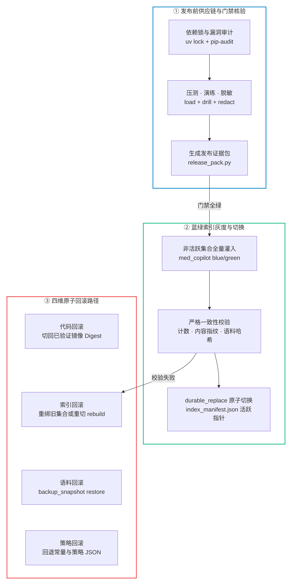

# 发布清单：灰度、恢复与回滚（Slice 7）

> 本清单描述**工程发布流程**。它不构成临床验收：医疗安全适当性由
> `medcopilot/datasets/policies/safety_policy_v1.json` 的评审记录与真实专家复核负责。

## 发布、蓝绿灰度与四维回滚全流程图



**图 1　发布、蓝绿灰度切换与四维原子回滚全流程**

## 1. 发布前证据包（一键）

```bash
MOCK_LLM=1 python medcopilot/scripts/load_check.py --output outputs/load_report.json
MOCK_LLM=1 python medcopilot/scripts/recovery_drill.py --output outputs/recovery_drill.json
python medcopilot/scripts/redact_scan.py outputs --output outputs/redact_scan.json   # 摘要只含计数，生产 profile 以此为证据
MOCK_LLM=1 python medcopilot/scripts/release_pack.py --profile opensource # → outputs/release_pack.json
```

- 证据包必须门：全量非 slow 测试、金标行为门（eval_golden 退出 0）、策略门禁
  （policy_check 退出 0）、配置镜像一致性、急救红旗验收集（emergency_eval，
  W1.1 红标召回/误报/降级准确三门槛）。
- 诚实项：`rag_quality`（eval_rag）在 mock 下按设计 FAIL、`clinical_signoff`
  （W6.2）在无资质签核时按设计 FAIL，均记录为 `expected_fail`。完整
  `--profile opensource` 的结论是 `engineering_pass_clinical_blocked`，
不是临床
  PASS；`--only` 子集始终是 `incomplete`。生产 profile 必须选择完整 gate 集、
显式
  `PROJECT_ENV=production`、关闭 Mock、具备 recovery/load/redaction evidence，
并通过
  maintainer signature 与 clinical signoff。
- 退出码分类：门进程以集合外退出码或超时（1800s）结束 → `crash`（证据包
  仍落盘，但无论必须与否一律阻断 `overall`）。
- 任何一项必须门失败 → `overall=fail`，禁止发布。

## 1.1 依赖锁与供应链检查（W5.2）

```bash
uv lock --check                                        # pyproject 与 uv.lock 是否同步
python medcopilot/scripts/export_lock.py --check  # 交付给镜像的 lock 是否新鲜
pip-audit --require-hashes --extra-index-url https://download.pytorch.org/whl/cpu \
    -r requirements.lock.txt                            # 按哈希集合审计（CI 同款命令）
```

- `requirements.lock.txt` 由 `export_lock.py` 从 `uv.lock` 生成：
**唯一**改动是把
  `torch==2.14.1+cpu` 这类本地版本号写成 `torch==2.14.1`。哈希一行不动，因此
  `--require-hashes` 仍把安装绑定到 PyTorch CPU 索引上的那个 wheel（实测：
去掉
  `--extra-index-url` 时 pip 会选中 PyPI 上哈希不同的 wheel 并被哈希校验拒绝）。
- 审计**不用** `--strict`：torch/torchaudio/torchvision 的 CPU 构建不在 PyPI 上，
  审计服务无法查询它们的公告；pip-audit 会在自己的 "skipped" 表里如实列出，
  这一缺口由哈希锁定 + SBOM 中的 wheel 指纹覆盖（容器构建命令见根 `Dockerfile`）。
- 镜像基线 `FROM python:3.12-slim@sha256:…` 是**摘要固定**，
GitHub Actions 全部固定
  到 commit SHA——标签可被重新指向，摘要与 SHA 不能。

## 2. 部署形态与硬约束

- **单 Worker**：会话存储（有界 LRU+TTL）与权威语料持久化均为进程本地；
  多实例会导致会话不互通与语料分叉。Docker/启动命令必须保持 `--workers 1`。
- 配置全部经 `AppConfig`/环境变量（见 `.env.example`），检查表：
  - `ADMIN_API_KEY`：生产必须设置（缺失 → 读写 503，fail-closed）。例外：
命中急救红线的请求在鉴权之前返回固定 120 警示（急救先于鉴权；
响应为常量安全文案，无数据泄漏面），普通读写仍一律 fail-closed。
  - `MED_TRUSTED_HOSTS`：Host 头白名单（逗号分隔，`*`=不限）；
生产应固定为对外主机名（防 Host 头注入/缓存投毒）。
  - `PROJECT_ENV`：**必须显式设置为 `production`/`prod`**（W1.3 默认拒绝）。
空值或错拼 → 读写 503；
上线前以 `/health` 的 `env_recognized == true` 且 `env_class` 为 production 作为阻断检查项。
  - `MED_SESSION_TTL_SECONDS` / `MED_SESSION_MAX_ENTRIES`：必须为正。
  - `MED_CORPUS_PATH`：生产建议设置（启用幂等摄取与重启恢复）。
  - `SAFETY_POLICY_PATH`：默认即仓库工件；勿指向未评审副本。
  - `DOSAGE_GATE_MODE`：默认 `redact`；`quote` 仅当产品定位为“说明书原文引用”
且
    已接受逐字剂量展示时使用（quote 模式仍强制安全章节在场）；生产禁用 `off`。
  - 临床签核（W6.2）：
`release_pack.clinical_signoff` 当前为 expected_fail（工件
    status=none）；资质评审人签核后（scripts/policy_sign.py approve-signoff）
该门
    自动转 PASS，应同步把 `required` 升级为 true 以阻断未签核发布。
  - `AUDIT_LOG_PATH` / `AUDIT_RETENTION_DAYS`：
生产必须设置（默认 `logs/audit.jsonl`、2190 天=6 年，
按 45 CFR §164.316(b)(2)(i)）；`/health.audit_ready` 必须为 true；
审计文件轮转/外送与 NTP 时钟同步为部署侧硬性要求。
  - **语料备份与恢复**：
`python medcopilot/scripts/backup_snapshot.py create <MED_CORPUS_DIR> <BACKUP_ROOT>` 每日快照；
`verify <SNAPSHOT_DIR>` 必须通过。目标 RPO ≤24h、RTO ≤30min；
恢复后执行 recovery drill。
  - `CORS_ORIGINS` / `CORS_ALLOW_ALL`：生产禁用 `CORS_ALLOW_ALL`。

## 3. 灰度：索引蓝绿切换即灰度原语

稠密索引的更新不覆盖旧索引，而是**构建新 collection → 校验 → 原子切换 manifest**：

1. 摄取/语料变更后执行 `POST /index/rebuild`（admin Bearer）。
2. 校验失败或检索异常时回滚 = 再次 rebuild 回到旧 collection 对应的语料状态；
   manifest 原子性保证任一时刻 serving 指向完整一致的索引。
3. 应用层灰度（单实例部署下）= 先在预发实例验证金标门与策略门禁，
再替换生产进程。

## 4. 恢复演练

**表 1　故障恢复演练对照**

| 故障 | 行为 | 恢复手段 |
| --- | --- | --- |
| 权威语料文件坏行 | 启动跳过坏行，`/health.corpus_degraded=true`，服务不中断 | 修复文件后重启；坏行清单见日志告警 |
| 进程重启 | 会话全部失效（进程内 LRU）；客户端收到 404 `session_expired` 后自动清理重开 | UI/客户端已内建重开语义 |
| 索引构建失败 | manifest 与活跃索引不变（构造性回滚） | 修复 encoder 后再次 rebuild |
| 语料写盘失败 | 摄取整体失败，磁盘与内存均保持原状（write-through） | 释放磁盘后重试摄取 |
| 策略工件损坏 | 门控逐字节不变（fail-safe），`/health` 报 invalid | 修复工件或回退 Git 版本 |

## 5. 回滚

- **代码**：回退到上一个已验证的 Git 提交或发布标签（每个切片独立提交，
支持原子回退）。
- **索引**：见第 3 节蓝绿语义；manifest 指针只前进，回滚通过重建旧语料状态实现。
- **语料**：`MED_CORPUS_PATH` 指向的 JSONL 是唯一事实来源；回滚 = 用 Git 历史或
  备份副本替换后重启（摄取幂等，重放安全）。
- **策略工件**：任何策略变更都有 Git 历史与评审记录；回退工件必须连带回退代码
  常量（等价守护测试会强制二者一致）。

## 6. 已知边界

- 负载检查只验证连接层健康（零错误 + 有界延迟），
吞吐与容量结论须在目标硬件测量。
- 多实例部署、共享语料/会话状态、压测与混沌演练需基础设施支持，
不在本仓库范围。
- 真实供应商线上联调（云端 LLM / Embedding / Reranker / OCR）
需在具备合规授权与真实密钥的目标环境中单独验收。
