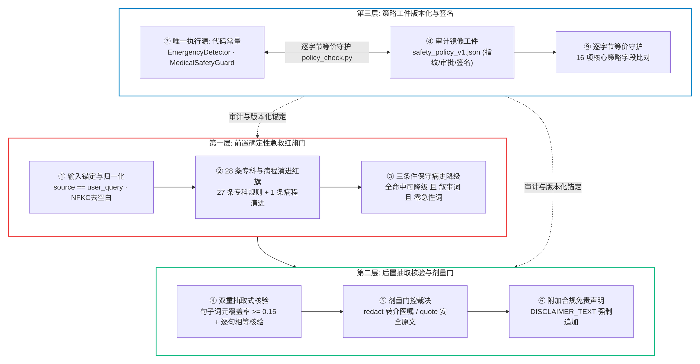
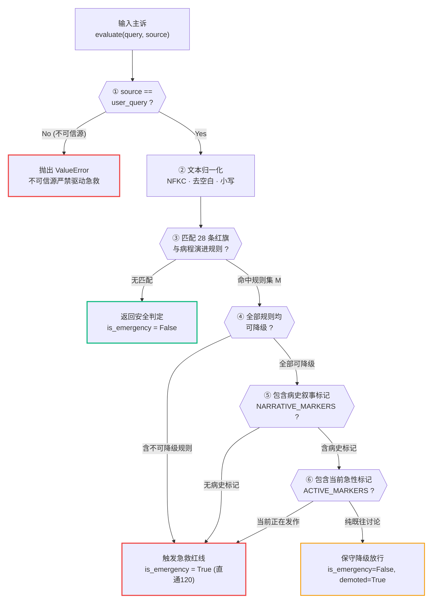
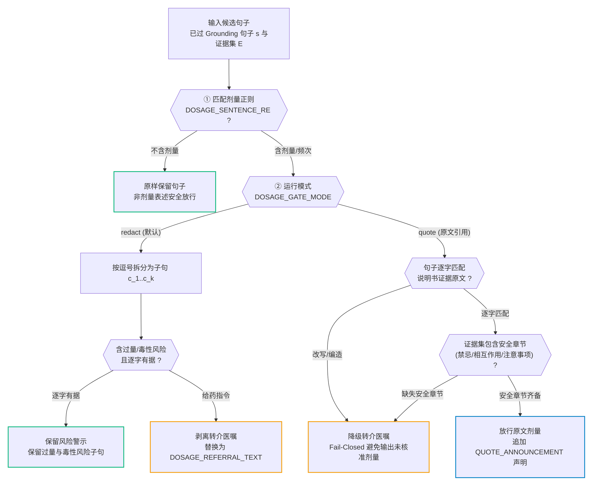
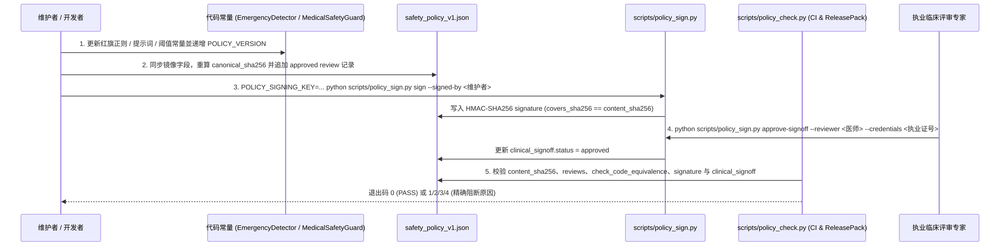

# 医疗安全策略、急救红旗、剂量门与专家复核规范（Clinical Safety Guardrails & Policy Specification）

本文档定义 `medcopilot` 的三层确定性医疗安全护栏体系：
**前置急救红旗与病程演进短路门（`EmergencyDetector`）**、
**后置抽取式忠实度核验与双模式剂量门（`MedicalSafetyGuard` & `DosageGate`）**，
以及**版本化安全策略审计镜像、HMAC-SHA256 签名与临床专家复核流程（`safety/policy.py`）**。

---

## 三层确定性医疗安全护栏架构图



**图 1　三层确定性医疗安全护栏架构**

---

## 1. 定位与核心不变量

- **运行时安全门控的执行源永远是代码常量**（`EmergencyDetector` / `MedicalSafetyGuard` / `TriageAgent` / `AppConfig` 默认值）。
- `medcopilot/datasets/policies/safety_policy_v1.json` 是执行源的**审计与版本化镜像**：
它记录急救模式串（含顺序）、警示文本、非医疗关键词、医疗提示词、
grounding 停用词、免责声明文本与默认阈值，并携带内容指纹、维护者签名、
临床签核状态与评审记录。
- **fail-safe（故障导向安全）**：工件缺失、损坏或评审未通过时，
`/health` 如实报告（`policy_review_status: invalid / not-approved`），
但任何实际门控行为逐字节不变；服务与急救拦截不受影响。

---

## 2. 第一层：确定性急救红旗与病程演进门（`workflow/emergency_detector.py`）

### 2.1 急救红旗判定与三条件保守病史降级决策树



**图 2　急救红旗判定与三条件保守病史降级决策树**

### 2.2 核心规则族与不变量

1. **输入源锚定防护（Anchoring Defense）**：
   `EmergencyDetector.evaluate(query, *, source="user_query")` 强制要求 `source == "user_query"`，
若传入 `"ocr"`、
`"history"` 等不可信来源直接抛出 `ValueError`（防止药盒说明文字中的“休克/中毒”
误触发急救，或历史文本抑制当前急救）。
2. **抗绕过文本归一化（`normalize_text`）**：
   依次执行 Unicode `NFKC` 归一（全角转半角）
$\rightarrow$ 剥离全部空白字符（防御 `"心 肌 梗 死"` 或 `"kill myself"` 插空格绕过）
$\rightarrow$ `.casefold()` 大小写折叠。
3. **28 条专科红旗与病程演进规则族（27 条专科 + 1 条病程演进）**：
   覆盖心脑血管（`cv.mi`、`cv.acs.chestpain`、`cv.chestpain.bare`、
`cv.stroke`、`cv.stroke.keywordfree` FAST-120 口语卒中、`cv.thunderclap`、
`cv.dissection`、
`cv.hypertensive.crisis` 收缩压 $\ge 180$ 或舒张压 $\ge 120$ 伴症状）、
神经系统（`ns.seizure`、`ns.febrile.seizure`、`ns.conscious`、
`ns.meningitis`）、外伤出血（`tr.major.bleeding`、`tr.severe.trauma`、
`tr.burn`）、中毒与服药过量（`po.drug.overdose`、`po.pesticide`、
`po.general`、`po.other.toxin`、`po.overdose.en`）、精神自伤（`mh.suicide`、
`mh.suicide.en`，**永不降级**）、产科急症（`ob.hemorrhage`）、
呼吸急症（`resp.arrest`、`resp.status.asthma`，**永不降级**）、
过敏性休克与酮症酸中毒（`al.shock`、`other.dka`）
及病程进行性恶化（`traj.escalating-symptom`，**永不降级**）。

---

## 3. 第二层：抽取式忠实度核验与双模式剂量门（`workflow/safety_guard.py`）

### 3.1 抽取式忠实度核验数学定义（`check_groundedness` & `check_extractive_support`）

设剥离免责声明后的模型回答为 $A$，
本次检索召回并送入 Prompt 的证据文本拼接为 $E$。
词元提取器 $\operatorname{Tok}(\cdot)$ 按正则 `[\u4e00-\u9fff]{2,}|[A-Za-z]{2,}|\d+(?:\.\d+)?` 提取多字词元（≥2 个汉字/字母或数字，
杜绝单字虚词凑数），
停用词集合 $\Sigma_{\text{stop}}$ 为 12 个双字虚词（safety_guard.STOP_WORDS：
可以/如果/但是/因为/所以/这个/那个/建议/患者/出现/引起/注意）。
回答按 `[。！？\n]` 切分并保留长度 $\ge 4$ 的句子：

$$
S_{\ge 4}(A) = \left\{\, s \in \operatorname{split}(A) : \lvert s \rvert \ge 4 \,\right\} \tag{1}
$$

式中：
- $\operatorname{split}(\cdot)$ —— 按句末标点 `[。！？\n]` 的切分；
- $\lvert s \rvert \ge 4$ —— 短句在切分阶段即被剔除，不进入分子或分母（防止单字虚词凑数）。

证据的全量词元集合为：

$$
T(E) = \operatorname{Tok}(E) \setminus \Sigma_{\text{stop}} \tag{2}
$$

式中：
- $T(E)$ —— 证据拼接文本的词元集合；
- $\Sigma_{\text{stop}}$ —— 12 个双字虚词停用词（safety_guard.STOP_WORDS）。

第一重**句子词元覆盖率**判据统计"与证据共享至少一个词元"的长句占比，
要求不低于阈值 $\tau_{\text{ground}} = 0.15$（`groundedness_threshold`）：

$$
\operatorname{GroundingRatio}(A, E) = \frac{\left\lvert \left\{ s \in S_{\ge 4}(A) : \left(\operatorname{Tok}(s) \setminus \Sigma_{\text{stop}}\right) \cap T(E) \neq \emptyset \right\} \right\rvert}{\lvert S_{\ge 4}(A) \rvert} \ge \tau_{\text{ground}} \tag{3}
$$

式中：
- $\operatorname{Tok}(s) \setminus \Sigma_{\text{stop}}$ —— 句子词元去停用词；
- $T(E)$ 定义见式(2)；
- 免责声明由后处理在 grounding 之后追加，不进入本判据输入；免责正则过滤仅见于 `scripts/eval_rag.py` 的 faithfulness 代理。

第二重**整句相等核验**将回答与证据分别归一化为句子集合，
要求回答的每个句子与某条证据句**完全相等**——是集合隶属而非子串包含（"禁止每日服用 9 片"裁剪出的"每日服用 9 片"不是任何证据句，
因此被阻断）：

$$
\forall s \in \operatorname{NormSent}(A),\quad \exists e_j \in \operatorname{NormSent}(\mathcal{E})\;\;\text{s.t.}\;\; \operatorname{norm}(s) = \operatorname{norm}(e_j) \tag{4}
$$

式中：
- $\operatorname{NormSent}(\cdot)$ —— 按多种句界切分后剥离空白并 casefold 的归一化句子集合；
- $\operatorname{norm}(\cdot)$ —— 单句归一化（剥离空白 + casefold）；
- $\mathcal{E}$ —— 证据分块集合。

### 3.2 双模式确定性剂量门决策流程图（`DosageGate`）



**图 3　双模式确定性剂量门（redact/quote）裁决流程**

---

## 4. 第三层：策略工件内容指纹、签名与专家复核流程（`safety/policy.py`）

### 4.1 策略变更、签名与门禁验证时序图



**图 4　策略工件签名与临床专家签核时序**

### 4.2 内容指纹与 HMAC-SHA256 签名公式

`safety_policy_v1.json` 中 `content` 对象的规范化内容指纹定义为：

$$
\text{content\_sha256} = \operatorname{SHA256}\Big(\operatorname{UTF8}\big(\operatorname{json\_dumps}(\text{content},\; \text{sort\_keys}=\text{True},\; \text{ensure\_ascii}=\text{False})\big)\Big) \tag{5}
$$

式中：
- $\text{content}$ —— safety_policy_v1.json 的 content 内容对象；
- $\operatorname{json\_dumps}(\cdot)$ —— sort_keys=True、
ensure_ascii=False 的规范化序列化。

当启用维护者密钥签名（`POLICY_SIGNING_KEY`）时，
签名消息体与 HMAC-SHA256 摘要定义为：

$$
\text{sig\_hmac} = \operatorname{HMAC-SHA256}\Big(K_{\text{signing}},\; \operatorname{UTF8}\big(\operatorname{json\_dumps}(\{\,\text{policy\_version},\; \text{content}\,\},\; \text{sort\_keys}=\text{True},\; \text{ensure\_ascii}=\text{False})\big)\Big) \tag{6}
$$

式中：
- $K_{\text{signing}}$ —— 维护者签名密钥（环境变量 POLICY_SIGNING_KEY 注入，
绝不入库）；
- MAC 消息体是 $\{\text{policy\_version}, \text{content}\}$ 二元组的 canonical JSON——$\text{signed\_by}$ 与 $\text{date}$ 是签名记录的外置字段，
**不参与**摘要计算；
- content 的任何单字节改动都会使 $\text{covers\_sha256}$ 失配，
签名与全部评审记录同时失效。

任何对 `content` 的单字节修改都会改变 `content_sha256`，
从而使旧的 `reviews[*].covers_sha256`、
`signature.covers_sha256` 与 `clinical_signoff.covers_sha256` 同时失效（`PolicyReviewError`）。

### 4.3 评审门与记录字段

工件生效要求存在至少一条 `decision == "approved"` 且 `covers_sha256` 等于当前内容指纹的评审记录。
`policy_version` 递增或内容变更后，
旧评审自动失效——**必须追加新的 approved 记录**。

**表 1　评审记录字段规范**

| 字段 | 说明 |
| --- | --- |
| `review_id` | 唯一评审标识 |
| `decision` | `approved` / `pending` / `rejected` |
| `covers_sha256` | 该评审覆盖的内容指纹 |
| `reviewer` | 评审人身份，**必须如实签署**，禁止伪造专家身份 |
| `date` | 评审日期（ISO） |
| `scope` | 评审范围 |
| `notes` | 说明；bootstrap 记录必须如实声明其非临床性质 |

#### bootstrap 记录

首条记录由自动化工程流水线签署，如实声明：**非临床专家评审**，
仅确认工件与代码常量逐字节一致；
策略的临床适当性依赖后续由具备资质的评审人追加的 approved 记录。

### 4.4 变更流程

1. 修改代码常量（或工件内容），保持二者一致。
2. 用 `canonical_sha256(content)` 重算指纹，更新 `content_sha256`，
递增 `policy_version`。
3. 追加新的 approved 评审记录（`covers_sha256` = 新指纹），如实签署评审人。
4. 运行门禁与回归：
   ```bash
   MOCK_LLM=1 python medcopilot/scripts/policy_check.py          # 退出 0
   MOCK_LLM=1 python -m pytest medcopilot/tests/test_medcopilot_safety_policy.py medcopilot/tests/test_medcopilot_golden_eval.py -v
   ```

### 4.5 门禁语义（`medcopilot/scripts/policy_check.py`）

**表 2　policy_check.py 退出码语义**

| 退出码 | 含义 |
| --- | --- |
| 0 | 工件通过评审门且与代码常量逐字节一致（stdout 含 `PASS`） |
| 1 | 评审门失败（指纹不符 / 无覆盖当前指纹的 approved 评审）或内容偏离代码常量 |
| 2 | 工件结构性非法（缺失、坏 JSON、未知字段、正则不可编译等） |
| 3 | `--require-signature` 模式下缺少有效的维护者 HMAC-SHA256 签名 |
| 4 | `--require-signoff` 模式下缺少具备资质的临床专家签核（`status != "approved"`） |

### 4.6 健康端点

`/health` 增量字段（旧客户端可忽略）：`policy_version`（int 或 null）、
`policy_matches_code`（bool）、
`policy_review_status`（`approved` / `not-approved` / `invalid` / `not-configured`）
、`policy_signature_present`（bool）、`clinical_signoff`（bool）。
这些字段只描述镜像状态，不构成门控本身。

### 4.7 边界声明

本机制提供**可追溯性与漂移检测**，不宣称替代真实临床审核；
策略内容的临床适当性必须由具备资质的评审人确认。
